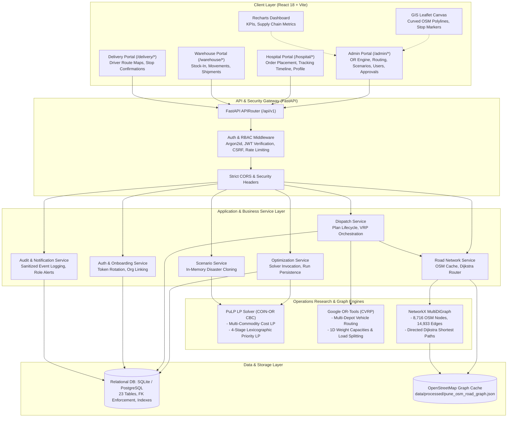
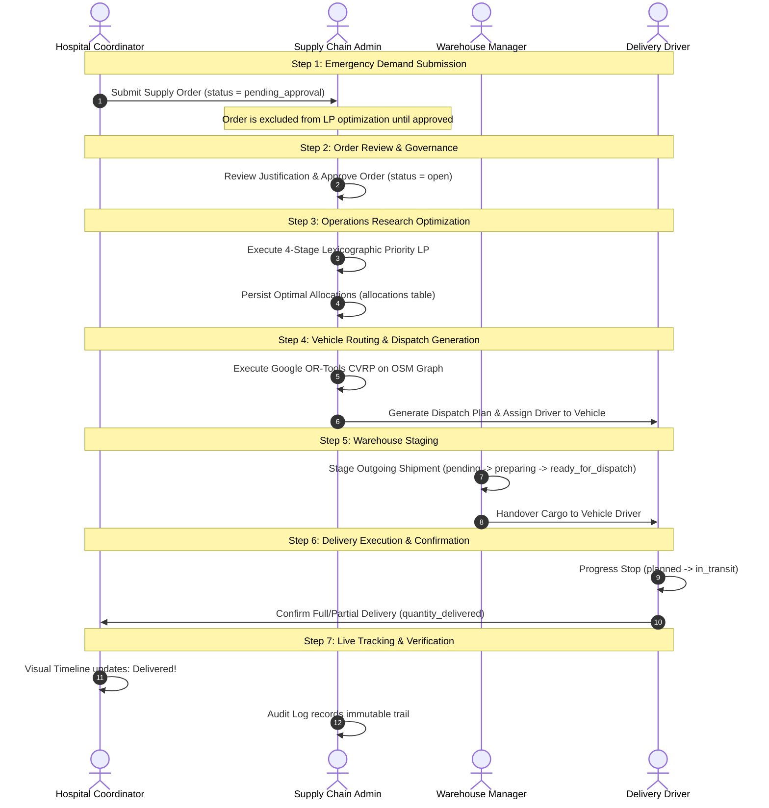

# MEDILOGIX

**Emergency Medical Supply Distribution Optimization Using Operations Research and Intelligent Decision Support**

[](https://www.python.org/)
[](https://fastapi.tiangolo.com/)
[](https://react.dev/)
[](https://vitejs.dev/)
[](https://coin-or.github.io/pulp/)
[](https://developers.google.com/optimization)
[](https://networkx.org/)
[](https://www.openstreetmap.org/)
[](https://tailwindcss.com/)
[](backend/tests/)

> **Repository**: [https://github.com/VishalKimbahune/MEDILOGIX-Emergency-Medical-Supply-Distribution-Optimization](https://github.com/VishalKimbahune/MEDILOGIX-Emergency-Medical-Supply-Distribution-Optimization)  
> **Academic Context**: B.Tech Final-Year Capstone Project in **Artificial Intelligence and Data Science**  
> **Author**: Vishal Kimbahune ([GitHub](https://github.com/VishalKimbahune) | [LinkedIn](https://www.linkedin.com/in/vishal-kimbahune-6b10b028b) | [Email](mailto:vishalkimbahune@gmail.com))

---

## Table of Contents

- [A. Overview](#a-overview)
- [B. Problem Statement](#b-problem-statement)
- [C. Project Objectives](#c-project-objectives)
- [D. Key Features](#d-key-features)
- [E. System Architecture](#e-system-architecture)
- [F. Technology Stack](#f-technology-stack)
- [G. Operations Research Methodology](#g-operations-research-methodology)
  - [1. Sets, Parameters, and Decision Variables](#1-sets-parameters-and-decision-variables)
  - [2. Multi-Commodity Transportation Linear Program (Model A)](#2-multi-commodity-transportation-linear-program-model-a)
  - [3. 4-Stage Sequential Lexicographic Priority Optimization (Model B)](#3-4-stage-sequential-lexicographic-priority-optimization-model-b)
  - [4. Multi-Depot Capacitated Vehicle Routing Problem (OR-Tools CVRP)](#4-multi-depot-capacitated-vehicle-routing-problem-or-tools-cvrp)
  - [5. Shortest-Path Road Network Routing (NetworkX Dijkstra)](#5-shortest-path-road-network-routing-networkx-dijkstra)
  - [6. Isolated Disaster Scenario Simulation](#6-isolated-disaster-scenario-simulation)
- [H. Data Science & Python Implementation](#h-data-science--python-implementation)
- [I. End-to-End Order Lifecycle & Multi-Role Governance](#i-end-to-end-order-lifecycle--multi-role-governance)
- [J. Project Structure](#j-project-structure)
- [K. Installation & Setup (Windows PowerShell)](#k-installation--setup-windows-powershell)
- [L. Running the Application](#l-running-the-application)
- [M. API Documentation](#m-api-documentation)
- [N. Testing & Verification](#n-testing--verification)
- [O. Dataset & Modeling Assumptions](#o-dataset--modeling-assumptions)
- [P. Map Data Attribution](#p-map-data-attribution)
- [Q. Application Screenshots](#q-application-screenshots)
- [R. Known Limitations](#r-known-limitations)
- [S. Realistic Future Enhancements](#s-realistic-future-enhancements)
- [T. Academic Context](#t-academic-context)
- [U. Author Information](#u-author-information)
- [V. License Notice](#v-license-notice)

---

## A. Overview

During humanitarian crises, epidemic outbreaks, or mass-casualty disaster events, regional healthcare supply chains face acute demand surges and supply shortages. Traditional logistics heuristics rely either on ad-hoc manual expediting or naive cost-minimizing transportation models. Under supply deficits, purely economic optimization systematically starves peripheral or high-urgency trauma facilities simply because delivering to them incurs higher transport costs.

**MEDILOGIX** is an end-to-end, full-stack decision-support platform that models emergency medical supply distribution as a dual-phase mathematical optimization problem:
1. **Strategic Allocation**: Solves warehouse-to-hospital multi-commodity linear programs using **PuLP** and the **COIN-OR CBC** solver, comparing standard transportation cost minimization against a **4-Stage Sequential Lexicographic Priority** formulation (Critical $\rightarrow$ High $\rightarrow$ Normal $\rightarrow$ Cost) to guarantee equitable triage.
2. **Tactical Operational Dispatch**: Ingests solved allocations directly into a multi-depot **Google OR-Tools Capacitated Vehicle Routing Problem (CVRP)** engine, executing over a cached real-world **OpenStreetMap (OSM)** directed road network (`8,716` intersection nodes, `14,933` directed edges) via **NetworkX** shortest-path Dijkstra algorithms.

The platform provides complete role-based governance across four distinct portals (**Admin Command**, **Hospital**, **Warehouse**, and **Delivery**), backed by enterprise-grade cryptographic authentication, append-only audit logging, and isolated disaster simulation.

```
       +--------------------------------------------------------------+
       |                         MEDILOGIX                            |
       |  Emergency Medical Logistics & Decision Support Platform    |
       +--------------------------------------------------------------+
                                      |
         +----------------------------+----------------------------+
         |                                                         |
         v                                                         v
+-------------------------------+                         +-------------------------------+
|    Operations Research (OR)   |                         |  Spatial GIS & Graph Routing  |
|  - Multi-Commodity LP         |                         |  - Real Pune / PCMC OSM Graph |
|  - 4-Stage Lexicographic Pri. |                         |  - NetworkX Directed Dijkstra |
|  - PuLP + COIN-OR CBC Solver  |                         |  - Google OR-Tools CVRP Tours |
+-------------------------------+                         +-------------------------------+
         |                                                         |
         +----------------------------+----------------------------+
                                      |
                                      v
       +--------------------------------------------------------------+
       |              Enterprise RBAC & Multi-Role Portals            |
       |  Admin Command | Hospital Portal | Warehouse | Delivery      |
       +--------------------------------------------------------------+
```

---

## B. Problem Statement

Medical supply chains during emergencies differ fundamentally from commercial retail logistics:

1. **Finite, Inelastic Supply**: Medical depots possess bounded physical stock of life-saving products (Oxygen Cylinders, Trauma Kits, IV Fluids, Essential Antibiotics).
2. **Asymmetric Clinical Priorities**: Demand cannot be treated homogeneously. An Intensive Care Unit running out of oxygen cylinders (Tier-1 Critical) has an immediate human-life risk compared to routine dispensary restocks (Tier-3 Normal).
3. **Flawed Economic Baselines**: Standard transportation cost optimization prioritizes hospitals closest to warehouses. Distant suburban or rural hospitals suffer severe, unacceptable supply starvation.
4. **Physical Fleet Constraints**: Transport vehicles have finite weight payload capacities (e.g., 800 kg to 2,500 kg), requiring multi-stop routing, load splitting, and vehicle reuse waves.
5. **Urban Graph Disruptions**: Real road networks feature one-way streets, commercial vehicle access bans, bridge collapses, flood-induced road closures, and localized hospital demand surges.
6. **Multi-Stakeholder Coordination**: Lack of end-to-end operational visibility between hospital coordinators, inventory managers, dispatch controllers, and delivery drivers causes shipment duplication and delivery delays.

---

## C. Project Objectives

- **Formulate Mathematical Allocation Models**: Construct a multi-commodity linear programming model in Python that eliminates arbitrary penalty tuning and prevents supply starvation through mathematical hierarchy.
- **Implement Strict Lexicographic Hierarchy**: Ensure that Critical (Tier 1) and High (Tier 2) demands achieve mathematical priority over Normal (Tier 3) replenishment before total transportation expenditure is considered.
- **Bridge Strategic LP to Operational CVRP**: Feed solved allocation decisions into a multi-depot Capacitated Vehicle Routing Problem without data loss, ensuring 100% shipment conservation across delivery vehicles.
- **Ingest Real OpenStreetMap Street Networks**: Extract and cache a directed graph of the Pune and Pimpri-Chinchwad municipal road network, enforcing one-way street topology, commercial truck restrictions, and real turn paths.
- **Simulate Disaster Disruptions**: Provide an isolated scenario analysis engine to model warehouse outages, closed road corridors, and demand surges without corrupting live operational database records.
- **Enforce Role-Based Access Control**: Implement four dedicated portals (Admin, Hospital, Warehouse, Delivery) secured by Argon2id password hashing, rotating HTTP-only refresh cookies, short-lived JWTs, and append-only audit logging.
- **Deliver an Interactive Decision-Support UI**: Provide interactive Leaflet GIS visualization with street-accurate polyline rendering, live KPI summary cards, Recharts analytical dashboards, and one-click order approval actions.

---

## D. Key Features

### 1. Master Data & Entity Management
- **Warehouses**: Manage multi-depot facilities with physical geographic coordinates (WGS84 latitude/longitude), storage capacity, and operational status (`active`, `inactive`, `maintenance`).
- **Hospitals**: Register acute-care hospitals with bed capacity, clinical emergency priority tier (`critical`, `high`, `normal`), urban sector, and contact profiles.
- **Medical Products**: Catalog essential commodities with unit specifications, gross unit weights (`kg`), and cold-chain flags (e.g., Oxygen Cylinders @ 15.0 kg, IV Fluid Cartons @ 12.0 kg, Trauma Kits @ 8.0 kg, Medicine Boxes @ 5.0 kg).
- **Inventory & Demands**: Full CRUD with foreign-key constraints, controlled stock-in entries, and immutable `StockMovement` history logs.

### 2. Operations Research Allocation Engine
- **Multi-Commodity Transportation Cost LP**: Minimizes total logistics cost across open warehouse-hospital links subject to available stock and demand satisfaction.
- **4-Stage Sequential Lexicographic Priority LP**: Formulates 4 sequential linear programs in PuLP to sequentially lock the minimum achievable shortfall fraction for Critical, then High, then Normal hospitals before optimizing transportation cost.
- **Side-by-Side Model Comparison**: Real-time comparative analytics evaluating transportation costs, unmet quantities, and tier-specific fulfillment percentages.
- **Immutable Optimization History**: Every run generates a timestamped `optimization_runs` record containing detailed pair-wise allocations (`allocations`), runtime metrics, and solver status strings.

### 3. OpenStreetMap GIS & NetworkX Shortest-Path Engine
- **Local Pune & PCMC Road Graph**: Directed `NetworkX MultiDiGraph` (`8,716` nodes, `14,933` directed edges, `8,517` one-way edges) cached in `data/processed/pune_osm_road_graph.json`.
- **Live Overpass Ingestion**: Standalone sync script (`data/fetch_osm_network.py`) capable of querying OpenStreetMap Overpass servers with automatic fallback to synthetic corridors.
- **Dual Routing Objectives**: Configurable optimization for **Minimum Road Distance** (meters) or **Minimum Estimated Travel Time** (seconds based on highway-class speed rules).
- **Road Network Management**: Interactive UI tab displaying graph density, connected components, closed OSM roads, and an interactive point-to-point shortest-path explorer.

### 4. Vehicle Routing & Fleet Dispatch (OR-Tools CVRP)
- **Multi-Depot Fleet Optimization**: Solves independent CVRP models per warehouse using Google OR-Tools with distance/time cost matrices and vehicle payload capacity limits.
- **Load Splitting & Wave Dispatch**: Automatically decomposes oversized hospital allocations that exceed vehicle capacities into feasible split stops.
- **Curved Street Geometry**: Stitches intermediate OSM node coordinates into `route_geometry_json` for exact street polyline rendering on Leaflet maps.
- **100% LP-to-VRP Conservation**: Verifies that the sum of planned shipment lines across all generated delivery stops exactly matches the LP allocation output.

### 5. Multi-Hazard Disaster Scenario Simulator
- **Non-Destructive Simulation**: Clones active master data into memory; zero writes to primary operational tables.
- **Five Predefined Crisis Profiles**:
  - *Depot Outage*: Primary warehouse disabled; tests network resilience under supply shifts.
  - *Road Closures*: Key transit arteries blocked (`is_closed = True` or specific OSM `way_id` removals).
  - *Emergency Demand Surge*: Hospital demand spikes up to +150% in affected sectors.
  - *Fleet Disruption*: Sudden vehicle breakdowns and reduced transport capacity.
  - *Combined Catastrophe*: Simultaneous warehouse shutdown, road cuts, and demand surge.
- **Delta Impact Metrics**: Computes exact numeric deltas for cost increase, unfulfilled critical units, and route rerouting overhead.

### 6. Four Dedicated Role Portals & Governance
- **Admin Command (`/admin/*`)**: System-wide control over OR solver runs, fleet vehicle provisioning, dispatch plan generation, disaster simulations, user account approvals, order approvals, and audit log inspection.
- **Hospital Portal (`/hospital/*`)**: Emergency supply order drafting, medical justification input, live 6-stage visual delivery timeline (`Submitted` $\rightarrow$ `Approved` $\rightarrow$ `Allocated` $\rightarrow$ `Dispatched` $\rightarrow$ `In Transit` $\rightarrow$ `Delivered`), and hospital profile management.
- **Warehouse Portal (`/warehouse/*`)**: Warehouse-scoped inventory management, stock-in entries with mandatory reason tracking, immutable movement history, and outgoing dispatch staging.
- **Delivery Portal (`/delivery/*`)**: Mobile-responsive driver dashboard with assigned route maps, sequential stop checklists, and digital delivery confirmations.

---

## E. System Architecture

The following flowchart illustrates the complete flow of data from the React frontend, through the FastAPI backend and business services, into the Operations Research and GIS routing engines, down to the database and graph persistence layer:



---

## F. Technology Stack

| Layer | Technology | Version | Purpose in MEDILOGIX |
| :--- | :--- | :--- | :--- |
| **Backend Framework** | **Python** | 3.11+ | Core programming language for server logic, optimization, and data pipelines |
| | **FastAPI** | $\ge$ 0.115.0 | Asynchronous REST API framework with automatic OpenAPI / Swagger generation |
| | **Uvicorn** | $\ge$ 0.30.0 | High-performance ASGI web server |
| | **Pydantic** | $\ge$ 2.8.0 | Robust request/response schema validation and data serialization |
| **Frontend Framework** | **React** | 18.3.1 | Component-based reactive user interface |
| | **Vite** | 5.4.x | Fast build tool and modern development bundler |
| | **Tailwind CSS** | 3.4.x | Utility-first responsive styling framework |
| | **React Router** | 6.26.x | Client-side routing with role-based route guards (`RoleGuard`) |
| | **Axios** | 1.7.x | HTTP client with automatic JWT token attachment and 401 refresh interception |
| | **Lucide React** | 0.441.x | Clean, consistent UI icon library |
| **Visualization & GIS** | **Leaflet** | 1.9.4 | Interactive web mapping library |
| | **React Leaflet** | 4.2.1 | React bindings for Leaflet map views, polylines, and custom stop badges |
| | **Recharts** | 2.12.7 | Composable charting library for supply chain analytics and solver comparisons |
| **Operations Research** | **PuLP** | $\ge$ 2.9.0 | Linear programming modeling library interfacing with COIN-OR CBC |
| | **COIN-OR CBC** | Bundled | Open-source branch-and-cut linear programming solver |
| | **Google OR-Tools** | $\ge$ 9.10.0 | Routing engine solving the multi-depot Capacitated Vehicle Routing Problem (CVRP) |
| **Data Science & Graphs** | **NetworkX** | $\ge$ 3.3 | Graph manipulation library modeling the Pune/PCMC directed road graph |
| | **NumPy** | $\ge$ 1.26.4 | Numerical computations and distance array manipulations |
| | **Pandas** | $\ge$ 2.2.2 | Data transformation, CSV generation, and dataset validation |
| **Database & ORM** | **SQLAlchemy** | $\ge$ 2.0.32 | Python ORM with declarative mapping and strict foreign key integrity |
| | **SQLite** | 3.x | Lightweight local relational database (`backend/medilogix_dev.db`) |
| | **psycopg2-binary** | $\ge$ 2.9.9 | Production-ready PostgreSQL database driver |
| | **Alembic** | $\ge$ 1.13.2 | Database migration management tool |
| **Security & Auth** | **argon2-cffi** | $\ge$ 23.1.0 | Modern Argon2id cryptographic password hashing |
| | **PyJWT** | $\ge$ 2.9.0 | HS256 JSON Web Token issuance and validation |
| | **email-validator** | $\ge$ 2.2.0 | RFC-compliant email address validation |
| **Testing & Quality** | **pytest** | $\ge$ 8.3.2 | Backend automated testing framework (44 passing tests) |
| | **HTTPX** | $\ge$ 0.27.2 | Async HTTP client for integration test assertions |

---

## G. Operations Research Methodology

### 1. Sets, Parameters, and Decision Variables

#### Sets and Indices
- $I$: Set of active medical warehouses (depots), indexed by $i \in I$.
- $J$: Set of acute-care hospitals, indexed by $j \in J$, partitioned into mutually exclusive clinical priority tiers:
  $$J = J_{\text{crit}} \cup J_{\text{high}} \cup J_{\text{norm}}$$
- $K$: Set of medical commodities, indexed by $k \in K$ (Oxygen Cylinders, IV Fluids, Trauma Kits, Essential Medicines).
- $A \subseteq I \times J$: Set of active, open warehouse-to-hospital transportation corridors.
- $V_i$: Fleet of delivery vehicles available at warehouse $i \in I$, indexed by $v \in V_i$.

#### Parameters
- $S_{i,k} \ge 0$: Available physical inventory of product $k$ at warehouse $i$.
- $D_{j,k} \ge 0$: Requested demand for product $k$ by hospital $j$.
- $C_{i,j,k} \ge 0$: Unit transportation cost of delivering product $k$ from warehouse $i$ to hospital $j$, calculated as:
  $$C_{i,j,k} = \text{base\_cost}_{i,j} + (\text{distance\_km}_{i,j} \times \text{unit\_cost\_per\_km}_k)$$
- $w_k > 0$: Unit weight of product $k$ in kilograms ($\text{kg}$).
- $Q_v > 0$: Maximum payload capacity of vehicle $v$ in kilograms ($\text{kg}$).
- $A_{i,j} \in \{0, 1\}$: Corridor availability indicator ($1$ if route is open; $0$ if blocked/closed).

#### Decision Variables
- $x_{i,j,k} \ge 0$: Continuous variable representing quantity of product $k$ allocated from warehouse $i$ to hospital $j$.
- $u_{j,k} \ge 0$: Continuous variable representing unmet shortage of product $k$ at hospital $j$.
- $y_{a,b,v} \in \{0, 1\}$: Binary routing variable indicating vehicle $v$ travels directly from stop $a$ to stop $b$.

---

### 2. Multi-Commodity Transportation Linear Program (Model A)

Model A establishes the traditional economic baseline, minimizing total logistical transportation cost while satisfying supply and demand balances.

$$\min_{x, u} \quad Z_{\text{cost}} = \sum_{(i,j) \in A} \sum_{k \in K} C_{i,j,k} \, x_{i,j,k} + M \sum_{j \in J} \sum_{k \in K} u_{j,k}$$

Subject to:

1. **Warehouse Inventory Capacity**:
   $$\sum_{j \in J : (i,j) \in A} x_{i,j,k} \le S_{i,k} \quad \forall i \in I, \; \forall k \in K$$

2. **Hospital Demand Satisfaction**:
   $$\sum_{i \in I : (i,j) \in A} x_{i,j,k} + u_{j,k} = D_{j,k} \quad \forall j \in J, \; \forall k \in K$$

3. **Closed Corridor Blocking**:
   $$x_{i,j,k} = 0 \quad \forall (i,j) \notin A, \; \forall k \in K$$

4. **Non-Negativity**:
   $$x_{i,j,k} \ge 0, \quad u_{j,k} \ge 0 \quad \forall i \in I, \; \forall j \in J, \; \forall k \in K$$

*Flaw of Model A*: Under resource scarcity, the solver naturally drops demand at distant hospitals where $C_{i,j,k}$ is high, even if that hospital is an emergency trauma center.

---

### 3. 4-Stage Sequential Lexicographic Priority Optimization (Model B)

To guarantee clinical fairness, MEDILOGIX decomposes the allocation problem into four sequential linear programming stages solved via **PuLP** and **COIN-OR CBC**.

For each priority tier $P \in \{\text{crit}, \text{high}, \text{norm}\}$, let total tier demand be $D_P = \sum_{j \in J_P} \sum_{k \in K} D_{j,k}$. If $D_P > 0$, the normalized shortfall fraction is:

$$F_P = \frac{\sum_{j \in J_P} \sum_{k \in K} u_{j,k}}{D_P}$$

#### Sequential Solution Pipeline:

1. **Stage 1 (Minimize Critical Shortfall)**:
   $$\min \; F_{\text{crit}} \implies F_{\text{crit}}^*$$
   *(Locks optimal critical shortfall bound: $F_{\text{crit}} \le F_{\text{crit}}^* + \varepsilon$)*

2. **Stage 2 (Minimize High-Priority Shortfall)**:
   $$\min \; F_{\text{high}} \quad \text{subject to} \quad F_{\text{crit}} \le F_{\text{crit}}^* + \varepsilon \implies F_{\text{high}}^*$$

3. **Stage 3 (Minimize Normal-Priority Shortfall)**:
   $$\min \; F_{\text{norm}} \quad \text{subject to} \quad F_{\text{crit}} \le F_{\text{crit}}^* + \varepsilon, \; F_{\text{high}} \le F_{\text{high}}^* + \varepsilon \implies F_{\text{norm}}^*$$

4. **Stage 4 (Minimize Transport Cost Subject to All Locked Bounds)**:
   $$\min \; \sum_{(i,j) \in A} \sum_{k \in K} C_{i,j,k} \, x_{i,j,k}$$
   $$\text{s.t.} \quad F_{\text{crit}} \le F_{\text{crit}}^* + \varepsilon, \quad F_{\text{high}} \le F_{\text{high}}^* + \varepsilon, \quad F_{\text{norm}} \le F_{\text{norm}}^* + \varepsilon$$

Where $\varepsilon = 10^{-8}$ prevents numerical solver instability.

#### Verified Empirical Results (`RANDOM_SEED = 42` Synthetic Baseline)
On the standard 3-warehouse, 8-hospital, 4-product, 24-corridor Pune & PCMC benchmark:

| Performance Metric | Transportation Cost LP (Model A) | Lexicographic Priority LP (Model B) | Clinical Impact |
| :--- | :---: | :---: | :--- |
| **Total Demand** | 2,611 units | 2,611 units | Benchmark total |
| **Total Allocated** | 2,422 units (92.76%) | 2,422 units (92.76%) | Identical volume allocated |
| **Total Unmet Shortage** | 189 units | 189 units | Controlled deficit |
| **Total Transport Cost** | **₹134,932.40** | ₹144,463.31 (+7.06%) | +₹9,530.91 investment |
| **Critical Tier Fulfillment (913 req.)** | 91.68% (76 unmet) | **100.00% (0 unmet)** | **76 Critical lives safeguarded** |
| **High Tier Fulfillment (1,011 req.)** | 89.32% (108 unmet) | **98.71% (13 unmet)** | **95 High-priority units covered** |
| **Normal Tier Fulfillment (687 req.)** | **99.27% (5 unmet)** | 74.38% (176 unmet) | Routine restocks deferred |

> **Key Takeaway**: A modest **7.06% increase in transport cost** achieves **100% Critical Tier fulfillment** and eliminates 171 life-threatening shortages.

---

### 4. Multi-Depot Capacitated Vehicle Routing Problem (OR-Tools CVRP)

Once allocations $x_{i,j,k}^*$ are fixed by the LP, they are passed into the vehicle routing engine. The problem decomposes into independent CVRP instances for each warehouse depot $i \in I$.

For depot $i$, let $S_i$ be the set of delivery stops and node $0$ represent warehouse depot $i$.

$$\min \quad \sum_{v \in V_i} \sum_{a \in \{0\} \cup S_i} \sum_{b \in \{0\} \cup S_i} c(a, b) \, y_{a,b,v} + F_{\text{fixed}} \sum_{v \in V_i} z_v$$

Subject to:

1. **Degree Constraints**: Each delivery stop $s \in S_i$ is visited exactly once by exactly one vehicle.
2. **Depot Return**: Every vehicle tour starts and ends at warehouse depot node $0$.
3. **Vehicle Payload Capacity**:
   $$\sum_{s \in \text{tour}(v)} \sum_{k \in K} w_k \, q_{s,k} \le Q_v \quad \forall v \in V_i$$
4. **Subtour Elimination**: Enforced through OR-Tools routing model dimension variables.
5. **Exact LP-to-VRP Conservation**:
   $$\sum_{s \in S_i(j)} q_{s,k} = x_{i,j,k}^* \quad \forall j \in J, \; \forall k \in K$$

---

### 5. Shortest-Path Road Network Routing (NetworkX Dijkstra)

The cost matrix $c(a, b)$ is derived from the real-world Pune/PCMC OpenStreetMap directed graph:
- Let $G = (V_{\text{OSM}}, E_{\text{OSM}})$ be the directed graph.
- For every origin-destination pair $(a, b)$, the system computes the exact shortest path using Dijkstra's algorithm:
  $$c(a, b) = \min_{\text{path } P} \sum_{e \in P} \text{weight}(e)$$
- **Configurable Weights**:
  - `min_distance`: $\text{weight}(e) = \text{length\_meters}(e)$
  - `min_time`: $\text{weight}(e) = \frac{\text{length\_meters}(e)}{\text{speed\_mps}(e)}$
- One-way road directions (`oneway=True`) and heavy-goods delivery bans are strictly respected. Intermediate street coordinates are compiled into GeoJSON polylines for real-time map visualization.

---

### 6. Isolated Disaster Scenario Simulation

The disaster simulation engine (`app/simulation/scenario_engine.py`) allows decision-makers to evaluate extreme disruptive events:

- **Warehouse Outages**: Sets $S_{\hat{i}, k} = 0$ for disabled warehouse $\hat{i}$.
- **Road Corridor Closures**: Removes specific edges $e \in E_{\text{OSM}}$ or flags $A_{\hat{i}, \hat{j}} = 0$.
- **Hospital Demand Surges**: Applies multiplier $\alpha_j > 1.0$ (e.g., $D_{j,k}' = 2.5 \cdot D_{j,k}$).
- **Fleet Capacity Reductions**: Removes vehicles or restricts $Q_v$.

**Integrity Guarantee**: All simulations run on deep-copied data structures in memory. Live operational database records are never modified.

---

## H. Data Science & Python Implementation

### Python’s Core Role in MEDILOGIX
Python serves as the computational backbone of MEDILOGIX. Rather than acting as a simple CRUD script, the backend implements mathematical linear programming, graph traversal, and tabular data transformation.

```
                      +-----------------------------+
                      |     Python 3.11 Runtime     |
                      +-----------------------------+
                                     |
         +---------------------------+---------------------------+
         |                           |                           |
         v                           v                           v
+------------------+       +-------------------+       +-------------------+
|  NumPy & Pandas  |       |     NetworkX      |       |  PuLP & OR-Tools  |
| Array Math & CSV |       | Directed Graphs & |       | Exact LP & CVRP   |
| Preprocessing    |       | Dijkstra Shortest |       | Optimization      |
+------------------+       +-------------------+       +-------------------+
```

### 1. Data Science Libraries
- **Pandas (`pandas >= 2.2.2`)**: Used in dataset generation (`data/generate_dataset.py`) and validation (`data/validate_dataset.py`) to structure hospital coordinates, inventory matrices, and route costs into clean tabular frames.
- **NumPy (`numpy >= 1.26.4`)**: Powers vector calculations, matrix operations, and coordinate transformations between WGS84 coordinates and distance matrices.
- **NetworkX (`networkx >= 3.3`)**: Constructs and analyzes the directed multi-graph of Pune urban roadways, performing strongly connected component (SCC) analysis, dead-end detection, and directed Dijkstra shortest-path calculations.

### 2. Algorithmic Decision Support vs. Machine Learning
> **Important Distinction**: MEDILOGIX uses **Operations Research and Deterministic Optimization**, not black-box Machine Learning prediction. 
> 
> Optimization algorithms (Simplex, Branch-and-Cut, Dijkstra) provide **provably optimal or bounded mathematical solutions** for allocation and routing. In emergency medical logistics where decisions involve human lives, deterministic auditability and constraint satisfaction are clinically preferable to unconstrained probabilistic predictions. (Machine Learning demand forecasting is outlined under [Future Enhancements](#s-realistic-future-enhancements)).

---

## I. End-to-End Order Lifecycle & Multi-Role Governance

MEDILOGIX enforces strict multi-role governance with four distinct user roles:



### Detailed Lifecycle Stages:

1. **Hospital Order Submission**: Hospital coordinators request medical supplies via `/hospital/orders/new`. All orders enter `pending_approval`. They cannot bypass approval or self-allocate supplies.
2. **Admin Command Review**: The Admin reviews clinical justifications and clicks **[Approve Order]** on `/admin/demands`. This updates the order to `open` (`approval_status = "approved"`), making it eligible for optimization.
3. **Operations Research Allocation**: The Admin triggers optimization on `/admin/optimization`. The 4-Stage Lexicographic LP solves the allocation across active warehouses and approved demands.
4. **OR-Tools Route Generation**: The Admin runs VRP dispatch generation on `/admin/routes`. Google OR-Tools builds multi-stop routes adhering to vehicle payload limits and assigns each route to an approved Delivery Driver.
5. **Warehouse Cargo Preparation**: Warehouse Managers inspect outgoing dispatch orders on `/warehouse/shipments`, advancing them from `preparing` to `ready_for_dispatch`, logging stock movements.
6. **Driver Transit & Confirmation**: The Delivery Driver opens `/delivery/assignments`, navigates the curved OSM route, marks stops as `in_transit`, and records verified delivery quantities upon arrival.
7. **Audit & Timeline Update**: The delivery updates the Hospital’s visual 6-stage tracker to `Delivered`. The complete sequence is recorded in the append-only `audit_logs` table.

---

## J. Project Structure

```
MEDILOGIX-Emergency-Medical-Supply-Distribution-Optimization/
│
├── backend/                               # FastAPI Application & OR Services
│   ├── app/
│   │   ├── api/                           # REST API Endpoints & Route Definitions
│   │   │   ├── routes/
│   │   │   │   ├── admin.py               # Admin user approval, order review, audit logs
│   │   │   │   ├── analytics.py           # Supply chain overview & historical KPI metrics
│   │   │   │   ├── auth.py                # Argon2id authentication, JWT, cookie rotation
│   │   │   │   ├── delivery_portal.py     # Driver-scoped routes & delivery confirmation
│   │   │   │   ├── demands.py             # Demand request CRUD & filtering
│   │   │   │   ├── hospital_portal.py     # Hospital order creation & tracking timeline
│   │   │   │   ├── hospitals.py           # Hospital master data CRUD
│   │   │   │   ├── inventory.py           # Warehouse stock CRUD & balance lookups
│   │   │   │   ├── notifications.py       # Role-targeted user alerts
│   │   │   │   ├── optimization.py        # Transportation & Lexicographic LP endpoints
│   │   │   │   ├── products.py            # Medical product catalog endpoints
│   │   │   │   ├── routes.py              # OSM road network explorer & VRP dispatch API
│   │   │   │   ├── scenarios.py           # Disaster simulation endpoints
│   │   │   │   ├── warehouse_portal.py    # Stock-in movements & shipment preparation
│   │   │   │   └── warehouses.py          # Warehouse master data CRUD
│   │   │   ├── deps.py                    # RBAC security dependencies & IP extractors
│   │   │   └── error_handlers.py          # Centralized HTTP exception formatting
│   │   ├── core/                          # Security, hashing, configuration, rate limiter
│   │   ├── database/                      # SQLAlchemy connection & DB initialization
│   │   ├── models/                        # 23 SQLAlchemy Database ORM Models
│   │   │   ├── allocation.py              # LP solved allocation lines
│   │   │   ├── delivery.py                # Historical delivery records
│   │   │   ├── demand.py                  # Hospital supply demands & approval status
│   │   │   ├── dispatch.py                # DispatchPlan, VehicleAssignment, DeliveryStop
│   │   │   ├── hospital.py                # Hospital facilities & emergency tiers
│   │   │   ├── inventory.py               # Warehouse product inventory balances
│   │   │   ├── optimization_run.py        # Immutable solver execution history
│   │   │   ├── platform.py                # AuditLog, Notification, StockMovement
│   │   │   ├── product.py                 # Medical commodities (Oxygen, IV, etc.)
│   │   │   ├── road.py                    # Warehouse-hospital road links
│   │   │   ├── scenario.py                # Disaster scenario definitions
│   │   │   ├── scenario_run.py            # Scenario execution delta history
│   │   │   ├── user.py                    # User credentials, roles, refresh tokens
│   │   │   ├── vehicle.py                 # Fleet vehicle specs & driver link
│   │   │   └── warehouse.py               # Logistics hubs & storage capacities
│   │   ├── optimization/                  # Mathematical Engines
│   │   │   ├── linear_programming.py      # PuLP formulation base classes
│   │   │   ├── osm_road_network.py        # OSM Overpass parser & NetworkX graph engine
│   │   │   ├── priority.py                # 4-Stage Lexicographic Priority LP
│   │   │   ├── shortest_path.py           # NetworkX Dijkstra shortest-path calculations
│   │   │   ├── transportation.py          # Multi-Commodity Transportation Cost LP
│   │   │   └── vehicle_routing.py         # Google OR-Tools CVRP solver
│   │   ├── schemas/                       # Pydantic v2 Request/Response Validation Schemas
│   │   ├── services/                      # Application Business Logic
│   │   └── simulation/                    # Disaster Scenario Execution Engine
│   ├── scripts/                           # Utility & Provisioning Scripts
│   │   ├── create_admin.py                # Safe CLI initial Admin creator
│   │   └── seed_demo_accounts.py          # Optional local dev portal account seeder
│   ├── tests/                             # 44 Automated Pytest Tests (8 Suites)
│   ├── requirements.txt                   # Backend Python dependencies
│   └── .env.example                       # Backend environment template
│
├── frontend/                              # React 18 + Vite User Interface
│   ├── src/
│   │   ├── components/                    # Common UI components, tables, modals, maps
│   │   │   ├── common/                    # StatCard, StatusBadge, PageHeader, Modal
│   │   │   ├── forms/                     # Reusable form controls
│   │   │   ├── map/                       # Leaflet canvas map & curved polyline renderer
│   │   │   └── tables/                    # DataTable component with sorting & pagination
│   │   ├── context/                       # React AuthContext & ToastContext
│   │   ├── layouts/                       # MainLayout, Sidebar, Navbar, MobileNav
│   │   ├── pages/                         # Application Views
│   │   │   ├── admin/                     # UsersManagement, VehiclesManagement, AuditLogs
│   │   │   ├── auth/                      # Login, Register, ForgotPassword, ResetPassword
│   │   │   ├── delivery/                  # DeliveryDashboard, DeliveryAssignments
│   │   │   ├── hospital/                  # HospitalDashboard, HospitalCreateOrder, Orders
│   │   │   ├── warehouse/                 # WarehouseDashboard, WarehouseInventory
│   │   │   ├── Analytics.jsx              # Recharts supply chain visualizations
│   │   │   ├── Dashboard.jsx              # Admin operational command dashboard
│   │   │   ├── Demands.jsx                # Orders & Demands management with approval queue
│   │   │   ├── Hospitals.jsx              # Hospital master data management
│   │   │   ├── Inventory.jsx              # System-wide inventory balance view
│   │   │   ├── Optimization.jsx           # PuLP LP solver execution & comparison view
│   │   │   ├── Routes.jsx                 # OSM road network & OR-Tools dispatch interface
│   │   │   ├── Scenarios.jsx              # Disaster scenario simulation dashboard
│   │   │   └── Warehouses.jsx             # Warehouse master data management
│   │   ├── services/                      # Axios API service clients
│   │   ├── App.jsx                        # React Router layout & role-protected routes
│   │   └── main.jsx                       # React DOM root entry point
│   ├── package.json                       # Frontend dependencies & npm scripts
│   ├── tailwind.config.js                 # Tailwind CSS styling configuration
│   └── vite.config.js                     # Vite build configuration & server proxy
│
├── data/                                  # Spatial & Tabular Datasets
│   ├── processed/                         # Processed Pune/PCMC OSM graph JSON cache
│   ├── raw/                               # Unprocessed source references
│   ├── synthetic/                         # Reproducible synthetic baseline CSVs (Seed 42)
│   ├── fetch_osm_network.py               # OpenStreetMap Overpass extraction script
│   ├── generate_dataset.py                # Synthetic dataset generation script
│   └── validate_dataset.py                # Integrity validation script for synthetic data
│
├── docs/                                  # Comprehensive Technical Documentation
│   ├── api_documentation.md               # Complete REST API reference
│   ├── AUTHENTICATION_AND_RBAC.md         # Detailed security & RBAC permission matrix
│   ├── database_design.md                 # 23-table schema specification
│   ├── mathematical_model.md              # Mathematical LP & CVRP formulations
│   ├── system_architecture.md             # Multi-layer architecture documentation
│   └── USER_MANUAL.md                     # Step-by-step user operation guide
│
├── .env.example                           # Root environment template
└── README.md                              # This document
```

---

## K. Installation & Setup (Windows PowerShell)

Follow these exact, verified commands in **Windows PowerShell** to configure and run the project locally.

### 1. Prerequisites
- **Python**: Version 3.11 or higher installed (`python --version`)
- **Node.js**: Version 18.x or higher installed (`node -v`)
- **Git**: Installed and available in PATH (`git --version`)

### 2. Clone Repository
```powershell
git clone https://github.com/VishalKimbahune/MEDILOGIX-Emergency-Medical-Supply-Distribution-Optimization.git
cd "MEDILOGIX-Emergency-Medical-Supply-Distribution-Optimization"
```

### 3. Configure Environment Variables
```powershell
Copy-Item backend\.env.example backend\.env
Copy-Item frontend\.env.example frontend\.env
```

### 4. Backend Setup & Dependency Installation
```powershell
cd backend

# Create Python virtual environment
python -m venv .venv

# Activate virtual environment
.\.venv\Scripts\Activate.ps1

# Install backend dependencies
pip install -r requirements.txt
```

### 5. Initialize Database & Seed Master Data
```powershell
# Initializes 23 database tables in backend/medilogix_dev.db and loads synthetic seed data
python -m app.database.init_db
```

### 6. Provision Administrative User
```powershell
# Safely create your initial Administrator account (prompts for a secure password)
python scripts\create_admin.py --email admin@medilogix.org --name "System Administrator"

# (Optional) Seed 4 local development accounts for testing all four portals
python scripts\seed_demo_accounts.py
```

### 7. (Optional) OpenStreetMap Pune Graph Cache
The repository includes the cached Pune/PCMC OSM graph (`data/processed/pune_osm_road_graph.json`, ~8.15 MB). If you wish to re-fetch live map geometry:
```powershell
# From repository root
cd ..
backend\.venv\Scripts\python.exe data\fetch_osm_network.py
```

### 8. Frontend Setup & Dependency Installation
```powershell
cd frontend
npm install
```

---

## L. Running the Application

Open two separate Windows PowerShell terminal windows to run the full-stack system:

### Terminal 1: FastAPI Backend
```powershell
cd "d:\MEDILOGIX- Optimize Medical Supply Distribution\backend"
.\.venv\Scripts\Activate.ps1
uvicorn app.main:app --reload --host 127.0.0.1 --port 8000
```

### Terminal 2: React Frontend Development Server
```powershell
cd "d:\MEDILOGIX- Optimize Medical Supply Distribution\frontend"
npm run dev
```

### Access URLs & Endpoints

| Resource | URL | Purpose |
| :--- | :--- | :--- |
| **Frontend Web Application** | [http://localhost:5173](http://localhost:5173) | Interactive portal for Admin, Hospital, Warehouse, and Delivery |
| **Backend REST API Root** | [http://127.0.0.1:8000](http://127.0.0.1:8000) | Root API health status and welcome payload |
| **Interactive Swagger API Docs** | [http://127.0.0.1:8000/docs](http://127.0.0.1:8000/docs) | Interactive OpenAPI documentation and test interface |
| **ReDoc API Documentation** | [http://127.0.0.1:8000/redoc](http://127.0.0.1:8000/redoc) | Clean, readable REST endpoint specification |
| **Database File** | `backend/medilogix_dev.db` | Local SQLite relational database (23 tables) |

> **Security Note**: Never commit plaintext credentials. Administrative access must be created via `create_admin.py` or configured through environment variables.

---

## M. API Documentation

MEDILOGIX organizes its REST API endpoints into functional modules protected by role dependencies:

| Endpoint Route Group | Supported Methods | Description & Purpose | Enforced RBAC Role |
| :--- | :---: | :--- | :--- |
| `/api/auth` | `POST`, `GET`, `PATCH` | Registration, login, token refresh, logout, password recovery, profile update | Public / Authenticated |
| `/api/admin` | `GET`, `POST`, `PATCH` | User approvals, order approval/rejection, fleet vehicle assignments, audit logs | `ADMIN` only |
| `/api/hospital` | `GET`, `POST`, `PATCH` | Emergency supply ordering, 6-stage order timeline, hospital profile | `HOSPITAL` only |
| `/api/warehouse` | `GET`, `POST`, `PATCH` | Stock-in entries, movement history, status toggling, shipment preparation | `WAREHOUSE` only |
| `/api/delivery` | `GET`, `POST`, `PATCH` | Assigned OSM delivery routes, stop status progress, delivery confirmation | `DELIVERY` only |
| `/api/optimization` | `GET`, `POST` | Execute Transportation LP, Lexicographic LP, model comparison, run history | `ADMIN` only |
| `/api/routes` | `GET`, `POST` | OSM cache metrics, Dijkstra path explorer, OR-Tools CVRP dispatch generation | `ADMIN` only |
| `/api/scenarios` | `GET`, `POST` | Run isolated disaster simulations (warehouse outage, road cuts, demand surge) | `ADMIN` only |
| `/api/analytics` | `GET` | Aggregated supply chain metrics, solver comparison charts, fleet efficiency | `ADMIN` only |
| `/api/warehouses` | `GET`, `POST`, `PUT`, `DELETE` | Warehouse master entity CRUD operations | `ADMIN` only |
| `/api/hospitals` | `GET`, `POST`, `PUT`, `DELETE` | Hospital master entity CRUD operations | `ADMIN` only |
| `/api/inventory` | `GET`, `POST`, `PUT`, `DELETE` | Warehouse product inventory balance CRUD | `ADMIN` only |
| `/api/demands` | `GET`, `POST`, `PUT`, `DELETE` | Hospital demand requests CRUD and filtering | `ADMIN` only |
| `/api/products` | `GET`, `POST`, `PUT`, `DELETE` | Medical product catalog management | `ADMIN` / Authenticated |

---

## N. Testing & Verification

MEDILOGIX features an automated test suite verifying data models, operations research solvers, vehicle routing, road network shortest paths, disaster simulations, and RBAC security.

### 1. Run Backend Automated Test Suite
From the `backend/` directory with virtual environment activated:
```powershell
cd backend
pytest -v
```

#### Test Suite Breakdown (44 Automated Tests):
- `tests/test_api.py` (7 tests): Core master data CRUD, foreign-key validation, constraint enforcement.
- `tests/test_auth_rbac_portals.py` (7 tests): Argon2id hashing, short-lived JWT validation, HTTP-only cookie rotation, 4-portal permission isolation.
- `tests/test_dataset.py` (1 test): Synthetic dataset integrity, coordinate bounds, supply/demand balance.
- `tests/test_optimization.py` (9 tests): PuLP solver execution, Transportation LP, 4-Stage Lexicographic priority formulation, comparison engine.
- `tests/test_phase4_routing_dispatch_scenarios.py` (6 tests): Google OR-Tools CVRP solving, payload capacity constraints, disaster scenario isolation.
- `tests/test_phase5a_road_network.py` (4 tests): NetworkX graph parsing, directed one-way street enforcement, Dijkstra calculations.
- `tests/test_phase5b_osm_vrp_integration.py` (6 tests): End-to-end integration of OSM road network with OR-Tools CVRP routing.
- `tests/test_phase6_analytics_and_e2e_audit.py` (4 tests): End-to-end audit logging, delivery confirmation flow, analytics aggregation.

### 2. Frontend Production Build Verification
From the `frontend/` directory:
```powershell
cd frontend
npm run build
```
*Expected Output*: Vite bundles modules cleanly into `frontend/dist/` without JSX or syntax errors.

### 3. Dataset Validation
```powershell
backend\.venv\Scripts\python.exe data\validate_dataset.py
```
*Expected Output*: Confirms 0 schema violations, valid geodetic coordinates, non-negative stock/demand, and complete connectivity.

---

## O. Dataset & Modeling Assumptions

### 1. Geographic Scope
The operational area is anchored to **Pune Urban and Pimpri-Chinchwad, Maharashtra, India**, bounded by:
- Minimum Latitude: `18.40° N` | Maximum Latitude: `18.70° N`
- Minimum Longitude: `73.70° E` | Maximum Longitude: `74.05° E`

### 2. Synthetic Baseline Setup (`RANDOM_SEED = 42`)
- **Warehouses (3 Hubs)**: Fictional simulation hubs situated in Pimpri (`WH-01`), Hadapsar (`WH-02`), and Shivajinagar (`WH-03`).
- **Hospitals (8 Facilities)**: Synthetic profiles representing major acute-care healthcare institutions:
  - *Critical Tier (1)*: Shivajinagar Civic Trauma Center, Aundh District Care Hospital, Swargate Urban Referral Hospital.
  - *High Tier (2)*: Baner Emergency Medical Unit, Kondhwa Community Health Center, Pimpri-Chinchwad General Unit.
  - *Normal Tier (3)*: Kothrud Multi-Specialty Clinic, Hadapsar Industrial Area Hospital.
- **Medical Products (4 Commodities)**:
  - `PROD-01`: Oxygen Cylinders (15.0 kg/unit, non-cold-chain)
  - `PROD-02`: IV Fluid Cartons (12.0 kg/unit, non-cold-chain)
  - `PROD-03`: Trauma Kits (8.0 kg/unit, non-cold-chain)
  - `PROD-04`: Essential Medicine Boxes (5.0 kg/unit, cold-chain sensitive)

### 3. Estimated Travel Times
Travel times across the OpenStreetMap network are **estimated** using road-class speed profiles:
- Motorway: $60 \text{ km/h}$ | Trunk: $50 \text{ km/h}$ | Primary: $40 \text{ km/h}$
- Secondary: $32 \text{ km/h}$ | Tertiary: $25 \text{ km/h}$ | Residential: $20 \text{ km/h}$

> **Disclaimer**: All hospital demands, warehouse inventory balances, and cost figures are illustrative synthetic numbers. They are designed for reproducible academic evaluation and do **not** represent real hospital patient records or confidential healthcare data.

---

## P. Map Data Attribution

Road network geometries, intersection coordinates, street names, and directional highway attributes are derived from **OpenStreetMap**:

- **Map Data**: © OpenStreetMap contributors
- **License**: Open Database License (ODbL) 1.0 — [https://www.openstreetmap.org/copyright](https://www.openstreetmap.org/copyright)
- **Map Tiles**: Leaflet default OpenStreetMap tile layers.

*Notice*: Travel durations are computed using assumed urban speed profiles and do not represent live traffic conditions.

---

## Q. Application Screenshots

To add screenshots to your GitHub repository:
1. Capture screenshots of the running application at `http://localhost:5173`.
2. Save them into a `docs/screenshots/` folder.
3. Replace the placeholder paths below with your image filenames.

### 1. Operations Research Allocation & Comparison

*Figure 1: Side-by-side comparison of Transportation Cost LP vs. 4-Stage Lexicographic Priority LP, showing 100% Critical Tier fulfillment.*

### 2. Interactive OpenStreetMap CVRP Route Viewer

*Figure 2: Street-accurate curved polylines generated via Google OR-Tools CVRP and NetworkX Dijkstra over Pune/PCMC OpenStreetMap.*

### 3. Hospital Order Submission & Live Tracking Timeline

*Figure 3: Hospital user interface displaying multi-product order creation and the 6-stage delivery progression tracker.*

### 4. Admin Orders & Demands Approval Center

*Figure 4: Prominent alert banner and review queue enabling Administrators to inspect and approve emergency hospital orders.*

---

## R. Known Limitations

- **Synthetic Operational Data**: The platform is evaluated using synthetic datasets generated with `RANDOM_SEED = 42`.
- **1D Weight Payload Capacity**: Vehicle routing models payload capacity in weight ($\text{kg}$); volumetric cubic capacity ($m^3$) and 3D bin packing are not currently implemented.
- **Estimated Travel Durations**: Road travel times use static street-class speed profiles; live traffic congestion (e.g., Google Maps Traffic API) is not integrated.
- **No Live GPS Telemetry**: Vehicle locations are updated sequentially through driver status progressions rather than real-time hardware GPS pings.
- **Continuous LP Variables**: Multi-commodity linear programming variables are continuous ($\ge 0$); fractional allocations are rounded cleanly before dispatch generation.
- **Controlled Inventory Deduction**: Confirming delivery increments `ShipmentLine.quantity_delivered` without automatically depleting physical warehouse stock, ensuring human-in-the-loop audit verification.

---

## S. Realistic Future Enhancements

The following extensions are planned as future research and engineering milestones:

1. **Machine Learning Demand Forecasting**: Train LSTM, Prophet, or XGBoost time-series models on historical epidemiological data to anticipate hospital demand surges 24–48 hours in advance.
2. **Live Traffic API Integration**: Connect NetworkX edge weights to real-time traffic providers (TomTom, HERE, or Google Distance Matrix API) for dynamic congestion rerouting.
3. **Vehicle Routing with Time Windows (VRPTW)**: Incorporate tight hospital delivery deadlines and warehouse dock operating windows into the OR-Tools model.
4. **Cold-Chain IoT Telemetry**: Track live sensor data (temperature, humidity, door-open alerts) for refrigerated biologicals and vaccine shipments.
5. **Multi-Objective Pareto Optimization**: Solve multi-objective formulations (NSGA-II) to yield a Pareto frontier balancing cost, time, and carbon emissions.
6. **Containerized Cloud Deployment**: Package backend, frontend, and database services into Docker containers managed with Kubernetes or Docker Compose.

---

## T. Academic Context

This project was conceived and implemented as a **B.Tech Final-Year Capstone Project in Artificial Intelligence and Data Science**.

It represents an interdisciplinary synthesis of:
- **Operations Research**: Multi-Commodity Linear Programming, Lexicographic Optimization, Combinatorial Optimization.
- **Graph Theory & Spatial Analysis**: Directed graphs, strongly connected components, Dijkstra shortest paths, WGS84 geodesy.
- **Data Science**: Reproducible synthetic modeling, data validation, comparative statistical analytics.
- **Software Architecture**: Enterprise RBAC, FastAPI asynchronous backends, React component design, and cryptographic security.

---

## U. Author Information

**Vishal Kimbahune**  
*B.Tech in Artificial Intelligence and Data Science*  

- **GitHub**: [@VishalKimbahune](https://github.com/VishalKimbahune)
- **LinkedIn**: [linkedin.com/in/vishal-kimbahune-6b10b028b](https://www.linkedin.com/in/vishal-kimbahune-6b10b028b)
- **Email**: [vishalkimbahune@gmail.com](mailto:vishalkimbahune@gmail.com)
- **Repository**: [MEDILOGIX-Emergency-Medical-Supply-Distribution-Optimization](https://github.com/VishalKimbahune/MEDILOGIX-Emergency-Medical-Supply-Distribution-Optimization)

---

## V. License Notice

This repository does not currently include a formal open-source license. An open-source license (such as the **MIT License** or **Apache License 2.0**) should be selected prior to public distribution and commercial reuse.

All OpenStreetMap road data and derived graphs are distributed under the **Open Database License (ODbL) 1.0** (© OpenStreetMap contributors).
