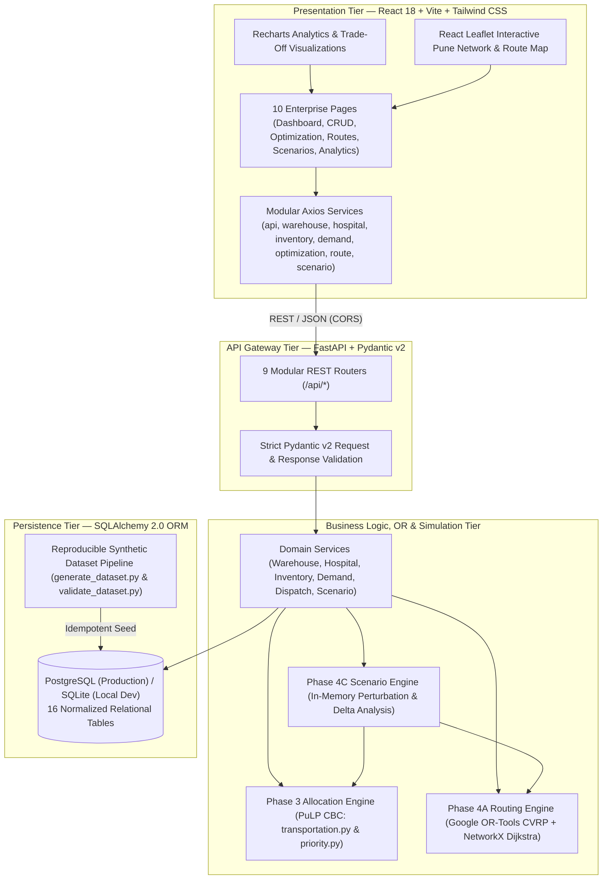
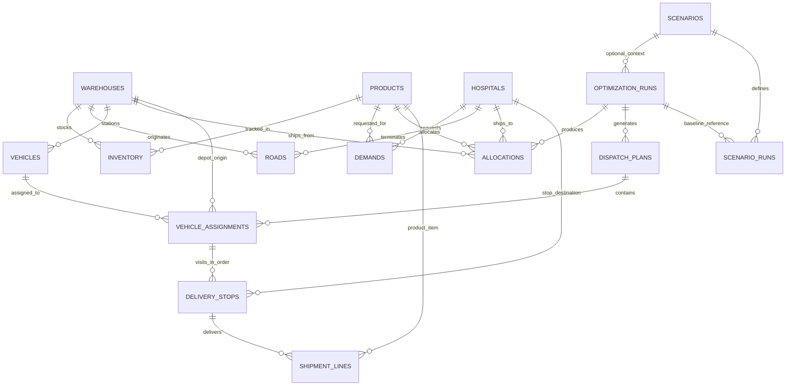
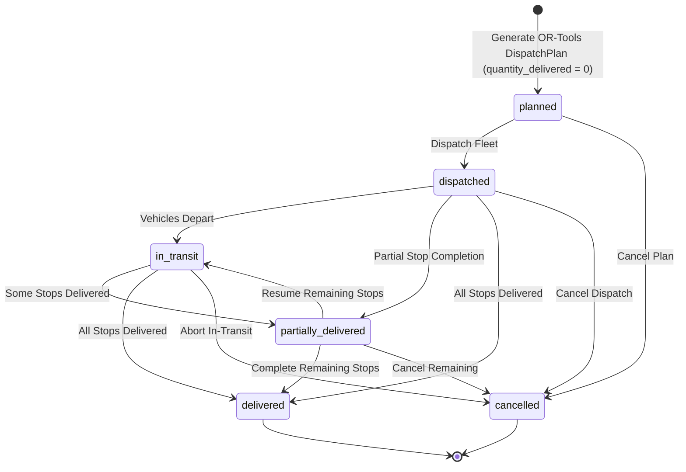
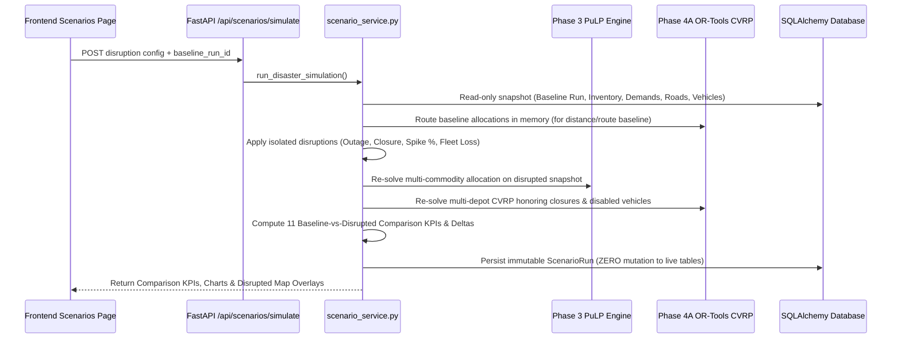

# MEDILOGIX: Emergency Medical Supply Distribution Optimization Using Operations Research and Intelligent Decision Support

**Comprehensive Technical, Architectural, Mathematical, and Verification Report**

| Metadata Field | Details |
| :--- | :--- |
| **Project Title** | MEDILOGIX — Emergency Medical Supply Distribution Optimization Using Operations Research and Intelligent Decision Support |
| **Domain** | Operations Research (OR) & Data Science / Supply Chain Management (DSCM) |
| **Geographical Simulation Scope** | Pune Urban Area & Pimpri-Chinchwad Municipal Corporation (PCMC), Maharashtra, India *(environment-configurable for Pune District expansion)* |
| **Completed Phases** | Phase 1 (Architecture & Data), Phase 2 (CRUD Management), Phase 3 (LP & Lexicographic Optimization), Phase 4 (OR-Tools VRP, Dispatch & Disaster Simulation) |
| **Core Stack** | React 18 (Vite, Tailwind CSS, Recharts, React Leaflet) · FastAPI · SQLAlchemy 2.0 · PuLP (CBC) · Google OR-Tools · NetworkX · PostgreSQL / SQLite |
| **Verification Status** | **37/37 Backend Automated Tests Passing** · **Frontend Production Build Passing** · **Synthetic Dataset Validation Passing** *(Updated through Phase 5–6 Final Audit)* |
| **Document Version** | 1.0 (Post-Phase 4 Release) |

---

## Executive Summary

During public health emergencies, natural disasters, and sudden mass-casualty surges, regional healthcare supply chains face simultaneous operational bottlenecks: finite medical warehouse inventory, heterogeneous hospital urgency, limited delivery fleet payload capacities, and disrupted urban road corridors. Traditional ad-hoc allocation or purely cost-driven logistics models frequently fail under shortage conditions—serving nearby, lower-priority facilities while critical trauma centers experience life-threatening stockouts.

**MEDILOGIX** is an end-to-end, production-style decision-support platform designed to solve this challenge through rigorous, transparent, and decoupled **Operations Research (OR)** algorithms integrated into a modern enterprise web platform. Built across four structured engineering phases for B.Tech final-year / Project-Based Learning (PBL) excellence, MEDILOGIX combines:

1. **Deterministic Supply Allocation (Phase 3 — PuLP CBC)**: Solves both a priority-neutral **Multi-Commodity Transportation Linear Program** and a **4-Stage Sequential Lexicographic Priority Shortage Model** (`Critical → High → Normal → Transport Cost`) without arbitrary penalty weights.
2. **Decoupled Multi-Depot Capacitated Vehicle Routing (Phase 4A — Google OR-Tools)**: Translates exact LP-allocated quantities into feasible, weight-capacitated, multi-stop closed-depot delivery tours per warehouse (`pywrapcp.RoutingModel`), strictly conserving every allocated unit.
3. **Persistent Dispatch Lifecycle Management (Phase 4B)**: Tracks `DispatchPlan`, `VehicleAssignment`, ordered `DeliveryStop`, and product-level `ShipmentLine` records through a validated 6-state operational workflow (`planned → dispatched → in_transit → partially_delivered / delivered / cancelled`).
4. **Isolated Disaster & Disruption Simulation (Phase 4C)**: Evaluates warehouse outages, road corridor closures, hospital demand surges, vehicle fleet losses, and combined disruptions against baseline optimization runs without mutating live operational tables.

### Headline Quantitative Findings (Reproducible `RANDOM_SEED = 42` Baseline)

On the verified 3-warehouse, 8-hospital, 4-product, 24-corridor Pune & PCMC synthetic network (`2,611` requested units with `189` unavoidable shortage units across Oxygen Cylinders and Trauma Kits):

- Switching from priority-neutral **Transportation Cost LP** to **4-Stage Lexicographic Priority Optimization** elevates **Critical hospital fulfillment from 91.68% to 100.00%** (eliminating all 76 critical unmet units) and **High-priority fulfillment from 89.32% to 98.71%** (eliminating 95 high-priority unmet units) for a modest **+7.06% (+₹9,530.91)** transportation cost trade-off (`₹134,932.40 → ₹144,463.31`).
- **Google OR-Tools Multi-Depot CVRP** routes all `2,422` allocated units (`24,173.0 kg` total payload) across `10` capacity-feasible closed tours using all `6` fleet vehicles (`15` ordered stops, `209.51 km` estimated total distance, `463.8 min` estimated total driving duration) with **zero capacity violations** and **100% LP quantity conservation**.
- Under a **Combined Monsoon Disruption** (`WH-03` outage + `RT-005` road closure + `+30%` demand spike at `HOSP-01` + `VEH-WH-01-01` unavailable), the decoupled architecture demonstrates its unique diagnostic value: Phase 3 LP still protects **100% Critical fulfillment**, while Phase 4A OR-Tools immediately flags a physical fleet payload bottleneck at `WH-01` (`11,375.0 kg` required vs. `9,600.0 kg` 3-wave single-truck capacity).

> [!IMPORTANT]
> **Academic Integrity & Data Provenance Policy**: All warehouse locations are explicitly designated as *Fictional Simulation Hubs*, and all hospital demand, inventory stock, travel times, and payload figures are *reproducible synthetic simulation data* (`RANDOM_SEED = 42`). Coordinates reflect general Pune and Pimpri-Chinchwad localities aligned with OpenStreetMap. Simulated route distances and travel times are analytical estimates and do **not** represent live traffic or real-time GPS vehicle tracking.

---

## 1. Problem Statement, Objectives & Scope

### 1.1 Operational Challenge

Emergency medical logistics differs fundamentally from commercial retail distribution:
- **Asymmetric Cost of Stockouts**: Failing to deliver Oxygen Cylinders to a Critical civic trauma center carries far higher human impact than delaying supplies to a Normal-tier clinic—even if the latter is geographically closer and cheaper to serve.
- **Multi-Commodity Complexity**: Essential supplies have distinct weights (`5.0 kg` to `18.5 kg` per unit), handling profiles (cold-chain vs. ambient), and independent warehouse availability.
- **Allocation vs. Routing Coupling**: Deciding *how much* each depot sends to each hospital is a continuous/linear network flow problem, whereas sequencing *which truck visits which hospitals* within payload limits is an NP-hard Capacitated Vehicle Routing Problem (CVRP).
- **Disruption Vulnerability**: Urban flooding (road closures), depot power/facility outages, ambulance/truck breakdowns, and localized trauma spikes rapidly invalidate static plans.

### 1.2 Engineering Objectives

1. Construct an academically defensible, mathematically verifiable Operations Research engine with **zero hardcoded optimization outputs**.
2. Provide full-stack CRUD management for Warehouses, Hospitals, Products, Inventory, and Demand Requests with strict referential integrity.
3. Implement sequential lexicographic priority optimization and side-by-side comparison against minimum-cost transportation LP.
4. Decouple LP supply allocation from multi-depot OR-Tools vehicle routing while mathematically guaranteeing conservation of allocated quantities.
5. Deliver an isolated disaster resilience simulator that quantifies allocation and routing impacts without corrupting live operational data.
6. Present all analytics, mathematical formulations, and Pune geospatial routes inside an intuitive enterprise SaaS dashboard.

### 1.3 Geographical Scope

The simulation models **Pune Urban Area and Pimpri-Chinchwad (PCMC), Maharashtra**, covering nine representative localities (`Pimpri`, `Shivajinagar`, `Aundh`, `Baner`, `Kothrud`, `Swargate`, `Kondhwa`, `Hadapsar`, and `Wagholi`) bounded by configurable environment variables (`GEO_MIN_LAT=18.40`, `GEO_MAX_LAT=18.70`, `GEO_MIN_LON=73.70`, `GEO_MAX_LON=74.05`) to allow zero-code expansion across the entire Pune district.

---

## 2. System Architecture & Technology Stack

### 2.1 Layered Software Architecture

MEDILOGIX employs a strictly separated four-layer architecture that keeps HTTP transport, domain services, Operations Research mathematics, and relational persistence independently testable and maintainable.



### 2.2 Technology Stack

| Layer | Technology | Role in MEDILOGIX |
| :--- | :--- | :--- |
| **Frontend Framework** | React 18.3, Vite 5.4, JavaScript (ES Modules) | Single-page enterprise application shell & modular page views |
| **Styling & Icons** | Tailwind CSS 3.4, Lucide React | Dark-navy (`#0b162c`) + teal (`#0d9488`) enterprise SaaS design system |
| **Data Visualization** | Recharts 2.13 | Supply-demand gaps, priority fulfillment, warehouse utilization, scenario deltas |
| **Geospatial Mapping** | React Leaflet 4.2, Leaflet 1.9, OpenStreetMap tiles | Depot/hospital markers, color-coded vehicle tours, stop badges, closed corridors |
| **Backend Framework** | Python 3.11, FastAPI, Uvicorn, Pydantic v2 | Modular typed REST API with automatic OpenAPI/Swagger documentation |
| **ORM & Database** | SQLAlchemy 2.0, PostgreSQL (`psycopg2-binary`), SQLite, Alembic | 16 normalized tables with FK enforcement (`PRAGMA foreign_keys=ON` on SQLite) |
| **Linear Programming** | PuLP 2.9 (`COIN-OR CBC` solver) | Multi-commodity transportation LP & 4-stage sequential lexicographic optimization |
| **Vehicle Routing & Graphs** | Google OR-Tools 9.15 (`pywrapcp`), NetworkX 3.6 | Multi-depot CVRP routing & Dijkstra shortest-path corridor lookups |
| **Data Processing & Testing** | NumPy, Pandas, Pytest, HTTPX | Dataset validation, notebooks, and 22 automated API/OR/simulation tests |

---

## 3. Database Design & Data Integrity Architecture

### 3.1 Entity-Relationship Model (16 Tables)

The relational schema separates **static/operational entities** (Warehouses, Hospitals, Products, Inventory, Demands, Roads, Vehicles) from **immutable analytical & execution artifacts** (OptimizationRuns, Allocations, DispatchPlans, VehicleAssignments, DeliveryStops, ShipmentLines, Scenarios, ScenarioRuns).



### 3.2 Core Tables & Migration Strategy

| Domain | Tables | Key Integrity Guarantees |
| :--- | :--- | :--- |
| **Master & Operational Data** | `warehouses`, `hospitals`, `products`, `inventory`, `demands`, `roads`, `vehicles` | Unique domain codes (`WH-01`, `HOSP-01`, `PROD-01`), composite unique constraints on `(warehouse_id, product_id)` and `(warehouse_id, hospital_id)`, non-negative stock/demand checks, `409 Conflict` deletion protection when dependent records exist. |
| **Phase 3 Optimization** | `optimization_runs`, `allocations`, `deliveries` | Immutable historical runs; `summary_json` stores complete run snapshots so repeated runs never overwrite or corrupt prior outputs. |
| **Phase 4B Dispatch** | `dispatch_plans`, `vehicle_assignments`, `delivery_stops`, `shipment_lines` | Cascading cleanup on plan removal, strict `RESTRICT` on master entity FKs, `quantity_delivered` initialized to `0.0` (never auto-delivered). |
| **Phase 4C Simulation** | `scenarios`, `scenario_runs` | Reproducible disruption parameters and baseline/disrupted metric snapshots referencing baseline `optimization_runs.id`. |

**Non-Destructive Schema Evolution**: FastAPI's `lifespan` handler (`backend/app/main.py`) and `backend/app/database/init_db.py` invoke `Base.metadata.create_all(bind=engine)`, safely creating new Phase 4 tables alongside existing Phase 1–3 tables without dropping or altering user data.

### 3.3 Data Integrity Invariants

1. **Zero Side-Effect Optimization**: Solving Phase 3 LP never mutates `inventory` or `demands`.
2. **Zero Side-Effect Dispatch Creation**: Creating a `DispatchPlan` records planned routes (`status = "planned"`) and never alters live warehouse stock or auto-completes deliveries.
3. **Zero Side-Effect Simulation**: Running any Phase 4C disaster scenario operates exclusively on in-memory snapshots—leaving `inventory`, `demands`, `vehicles`, `roads`, and baseline `optimization_runs` untouched.

---

## 4. Synthetic Dataset Pipeline & Validation

Implemented in `data/generate_dataset.py` and `data/validate_dataset.py` using a fixed deterministic seed (`RANDOM_SEED = 42`):

| Dataset File | Records | Contents & Controlled Properties |
| :--- | :---: | :--- |
| `warehouses.csv` | 3 | Fictional hubs in Pimpri (`WH-01`, 5,000 cap), Swargate (`WH-02`, 4,500 cap), and Wagholi (`WH-03`, 4,000 cap). |
| `hospitals.csv` | 8 | Synthetic hospital profiles across Shivajinagar, Aundh, Baner, Kothrud, Kondhwa, Hadapsar, Pimpri, Swargate (2 `critical`, 3 `high`, 3 `normal`). |
| `products.csv` | 4 | Oxygen Cylinders (`18.5 kg`), IV Fluid Cartons (`12.0 kg`), Trauma Kits (`6.5 kg`), Essential Medicine Boxes (`5.0 kg`, cold-chain). |
| `inventory.csv` | 12 | `3 × 4` warehouse-product stock records totaling `3,063` units. |
| `demands.csv` | 32 | `8 × 4` hospital-product open requests totaling `2,611` units. |
| `routes.csv` | 24 | Full `3 × 8` corridor matrix with Haversine × `1.28` tortuosity road distances and `28 km/h` synthetic travel times. |

**Controlled Supply Shortage Balance (Verified by `validate_dataset.py`)**:

| Product Code | Medical Product | Total Supply | Total Demand | Net Balance | Balance Status |
| :--- | :--- | :---: | :---: | :---: | :--- |
| `PROD-01` | Oxygen Cylinders | 380 | 525 | **−145** | Controlled Shortage |
| `PROD-02` | IV Fluid Cartons | 1,267 | 924 | +343 | Adequate |
| `PROD-03` | Trauma Kits | 310 | 354 | **−44** | Controlled Shortage |
| `PROD-04` | Essential Medicine Boxes | 1,106 | 808 | +298 | Adequate |
| **Total** | **All 4 Essential Supplies** | **3,063** | **2,611** | **+452** *(net)* / **−189** *(shortage)* | Validated (`PASS`) |

---

## 5. Mathematical Formulations & Operations Research Methodology

MEDILOGIX cleanly decouples **Stage I: Multi-Commodity Supply Allocation (PuLP CBC)** from **Stage II: Multi-Depot Capacitated Vehicle Routing (Google OR-Tools)**.

### 5.1 Stage I — Multi-Commodity Allocation LP (Phase 3)

#### Sets & Parameters
- $I$: Active warehouses; $J = J_{\text{crit}} \cup J_{\text{high}} \cup J_{\text{norm}}$: Active hospitals partitioned by emergency priority; $K$: Medical products; $A \subseteq I \times J$: Open road corridors ($A_{i,j} = 1$).
- $S_{i,k} \ge 0$: Net available stock (`available - reserved`) of product $k$ at warehouse $i$.
- $D_{j,k} \ge 0$: Open demand of product $k$ at hospital $j$.
- $C_{i,j,k} = \text{base\_cost}_{i,j} + \text{distance}_{i,j} \times \text{cost\_per\_km}_{k} \ge 0$: Unit transportation cost.

#### Decision Variables
- $x_{i,j,k} \ge 0$: Planned quantity of product $k$ allocated from warehouse $i$ to hospital $j$ (defined only for $(i,j) \in A$).
- $u_{j,k} \ge 0$: Unmet demand (shortage) of product $k$ at hospital $j$.

#### Core Linear Constraints
1. **Warehouse Stock Limit**:
   $$\sum_{j \in J : (i,j) \in A} x_{i,j,k} \le S_{i,k} \qquad \forall i \in I,\; \forall k \in K$$
2. **Hospital Demand Balance**:
   $$\sum_{i \in I : (i,j) \in A} x_{i,j,k} + u_{j,k} = D_{j,k} \qquad \forall j \in J,\; \forall k \in K$$
3. **Route Availability**: $x_{i,j,k} = 0$ for all $(i,j) \notin A$.
4. **Non-Negativity**: $x_{i,j,k} \ge 0,\; u_{j,k} \ge 0$.

#### Model A — Multi-Commodity Transportation LP (`transportation.py`)
Priority-neutral baseline avoiding arbitrary big-M penalty weights:
- **Stage 1**: $\min \; U = \sum_{j \in J, k \in K} u_{j,k} \implies U^*$
- **Stage 2**: $\min \; Z_{\text{cost}} = \sum_{(i,j) \in A, k \in K} C_{i,j,k} \, x_{i,j,k}$ subject to $\sum_{j,k} u_{j,k} \le \text{bound}(U^*)$.
- *(When `allow_unmet_demand=False`, $u_{j,k}=0$ is enforced directly and shortages yield `Infeasible`.)*

#### Model B — 4-Stage Sequential Lexicographic Priority Optimization (`priority.py`)
For each priority tier $P \in \{\text{critical}, \text{high}, \text{normal}\}$ with aggregate demand $D_P = \sum_{j \in J_P, k \in K} D_{j,k} > 0$, define the normalized unmet-demand fraction:

$$F_P = \frac{\sum_{j \in J_P} \sum_{k \in K} u_{j,k}}{D_P}$$

*(If $D_P = 0$, the stage is explicitly recorded as `Skipped (Zero Demand)` with $F_P = 0$ to prevent division by zero.)*

1. **Stage 1 (Critical)**: $\min \; F_{\text{crit}} \implies F_{\text{crit}}^*$
2. **Stage 2 (High)**: $\min \; F_{\text{high}}$ subject to $F_{\text{crit}} \le \text{bound}(F_{\text{crit}}^*) \implies F_{\text{high}}^*$
3. **Stage 3 (Normal)**: $\min \; F_{\text{norm}}$ subject to locked $F_{\text{crit}}^*, F_{\text{high}}^* \implies F_{\text{norm}}^*$
4. **Stage 4 (Transport Cost)**: $\min \; \sum_{(i,j) \in A, k \in K} C_{i,j,k} \, x_{i,j,k}$ preserving all three priority optimums, where $\text{bound}(f^*) = 0$ if $f^* \le 10^{-9}$ else $f^* + 10^{-8}$.

### 5.2 Stage II — Multi-Depot Capacitated Vehicle Routing (Phase 4A)

For each warehouse depot $i \in I$ with positive LP allocations to hospital subset $H_i \subseteq J$:
- Each hospital stop $s \in S_i$ carries exact product shipment lines $L_s$ derived from $x^*_{i,j,k}$, with total payload weight $q_s = \sum_{(k, q_{s,k}) \in L_s} w_k \, q_{s,k}$.
- Available home-depot vehicles $v \in M_i$ (`status == "available"`) have 1D payload weight capacity $Q_v$ (kg).
- **Objective** (solved via Google OR-Tools `pywrapcp.RoutingModel` using `PATH_CHEAPEST_ARC` + `GUIDED_LOCAL_SEARCH`):
  $$\min \sum_{v \in M_i} \sum_{(a,b)} d_{a,b} \, y_{a,b,v} + \sum_{v \in M_i} F \cdot z_v$$
- **Constraints**: Every stop visited once; every tour starts and ends at home depot $0$; $\sum_{s \in \text{tour}(v)} q_s \le Q_v$ enforced via zero-slack integer `AddDimensionWithVehicleCapacity`; closed corridors trigger explicit infeasibility diagnostics rather than silent detours.

---

## 6. Dispatch Lifecycle & Scenario Simulation Workflow

### 6.1 Dispatch State Machine (Phase 4B)



Invalid transitions (e.g., jumping directly from `planned` to `delivered`, or reopening `delivered`/`cancelled` plans) are rejected with HTTP `422`.

### 6.2 Disaster Scenario Simulation Pipeline (Phase 4C)



---

## 7. Quantitative Experimental Results & Analysis

All metrics below were computed dynamically by executing MEDILOGIX's actual PuLP CBC and Google OR-Tools engines on the baseline `RANDOM_SEED = 42` synthetic Pune & Pimpri-Chinchwad dataset.

### 7.1 Model Comparison: Transportation Cost LP vs. Lexicographic Priority LP

| Performance Metric | Multi-Commodity Transportation LP | 4-Stage Lexicographic Priority LP | Impact / Trade-Off |
| :--- | :---: | :---: | :---: |
| **Solver Status** | `Optimal` | `Optimal` | Both globally optimal |
| **Total Demand (units)** | 2,611 | 2,611 | Identical input |
| **Total Allocated / Unmet** | 2,422 / 189 (92.76%) | 2,422 / 189 (92.76%) | Maximum volume conserved |
| **Total Transport Cost (INR)** | **₹134,932.40** | ₹144,463.31 | +₹9,530.91 (+7.06%) |
| **Critical Tier Fulfillment (913 req.)** | 91.68% (76 unmet) | **100.00% (0 unmet)** | **−76 critical unmet (+8.32%)** |
| **High Tier Fulfillment (1,011 req.)** | 89.32% (108 unmet) | **98.71% (13 unmet)** | **−95 high unmet (+9.39%)** |
| **Normal Tier Fulfillment (687 req.)** | 99.27% (5 unmet) | 74.38% (176 unmet) | Shortage shifted to Normal tier |

**Key Insight**: Under controlled shortage, pure cost optimization allocates 99.27% of cheaper Normal-tier requests while leaving 76 Critical and 108 High-priority units unmet. Lexicographic optimization guarantees **100% Critical** and **98.71% High** coverage at only a 7.06% cost premium.

### 7.2 Product-Wise Allocation & Warehouse Utilization (Lexicographic Priority Baseline)

| Product | Supply | Demand | Allocated | Unmet | Fulfillment % | Transport Cost (INR) |
| :--- | :---: | :---: | :---: | :---: | :---: | :---: |
| `PROD-01` Oxygen Cylinders | 380 | 525 | 380 | 145 | 72.38% | ₹33,699.28 |
| `PROD-02` IV Fluid Cartons | 1,267 | 924 | 924 | 0 | 100.00% | ₹49,401.40 |
| `PROD-03` Trauma Kits | 310 | 354 | 310 | 44 | 87.57% | ₹21,583.21 |
| `PROD-04` Essential Medicine Boxes | 1,106 | 808 | 808 | 0 | 100.00% | ₹39,779.42 |

| Warehouse Depot | Available Stock | Planned Outbound | Remaining Stock | Utilization % | Transport Cost (INR) |
| :--- | :---: | :---: | :---: | :---: | :---: |
| `WH-01` Pimpri Regional Medical Hub | 1,155 | 973 | 182 | 84.24% | ₹68,368.06 |
| `WH-02` Swargate Central Emergency Depot | 1,035 | 1,035 | 0 | **100.00%** | ₹38,667.66 |
| `WH-03` Wagholi Eastern Logistics Hub | 873 | 414 | 459 | 47.42% | ₹37,427.59 |

### 7.3 Phase 4A Multi-Depot OR-Tools CVRP Results (Baseline Priority Run)

| Depot | Solver Status | Vehicles Used / Avail. | Closed Tours | Total Weight (kg) | Est. Distance (km) | Est. Duration (min) |
| :--- | :---: | :---: | :---: | :---: | :---: | :---: |
| `WH-01` (Pimpri) | `Optimal` | 2 / 2 | 4 | 9,765.0 | 93.39 | 206.8 |
| `WH-02` (Swargate) | `Optimal` | 2 / 2 | 4 | 10,020.0 | 51.29 | 119.8 |
| `WH-03` (Wagholi) | `Optimal` | 2 / 2 | 2 | 4,388.0 | 64.83 | 137.2 |
| **Network Total** | **`Optimal`** | **6 / 6** | **10 tours (15 stops)** | **24,173.0 kg** | **209.51 km** | **463.8 min** |

### 7.4 Phase 4C Disaster Scenario Stress-Test Results (vs. Baseline)

| Scenario | Outcome | Demand (Base → Dis.) | Unmet Units | Critical % | High % | Normal % | Transport Cost (INR) | Est. Route Dist (km) | Avail. Veh. | Feasible Routes |
| :--- | :---: | :---: | :---: | :---: | :---: | :---: | :---: | :---: | :---: | :---: |
| **Baseline (Priority LP + VRP)** | `Optimal` | 2,611 | 189 | 100.0% | 98.71% | 74.38% | ₹144,463.31 | 209.51 | 6 | 10 |
| **1. Swargate Outage (`WH-02`)** | `completed` | 2,611 → 2,611 | 583 (+394) | **100.0%** | 79.82% | 44.83% | ₹180,712.83 (+25.1%) | 228.68 (+9.1%) | 4 | 8 |
| **2. Shivajinagar Flood (`RT-001,009,017`)** | `completed` | 2,611 → 2,611 | 501 (+312) | **50.71%** | 100.0% | 92.58% | ₹115,247.00 | 188.01 | 6 | 9 |
| **3. Critical Surge (`+40%` HOSP-01,05)** | `completed` | 2,611 → 2,976.2 | 315.4 (+126.4) | **100.0%** | 90.07% | 68.70% | ₹170,436.38 (+18.0%) | 213.82 (+2.1%) | 6 | 11 |
| **4. Combined Monsoon Disruption** | **`partial`** | 2,611 → 2,746 | 556 (+367) | **100.0%** | 79.30% | 49.53% | ₹132,252.51 | 51.05 *(partial)* | 3 | 4 *(WH-01 overload)* |

**Strategic Insights for Emergency Planners**:
1. **Depot Resilience**: Even under a complete Swargate (`WH-02`) depot failure, lexicographic reallocation preserves **100% Critical fulfillment** using Pimpri and Wagholi hubs—at a 25.1% transport cost increase.
2. **Corridor Redundancy**: Closing all three arterial corridors into Shivajinagar (`HOSP-01`) drops Critical fulfillment in half (`50.71%`), proving that road access redundancy around Tier-1 trauma centers is irreplaceable by inventory alone.
3. **Fleet Bottleneck Detection**: In Scenario 4 (`WH-03` offline + `VEH-WH-01-01` offline + `+30%` spike at `HOSP-01`), LP allocation remains feasible, yet OR-Tools exposes a physical transport capacity failure at `WH-01` (`11,375.0 kg` required vs. `9,600.0 kg` 3-wave limit of the single remaining truck)—justifying mutual-aid vehicle staging in emergency preparedness plans.

---

## 8. Functional Modules & API Reference Summary

### 8.1 Frontend Enterprise Application (10 Pages)

| Page | Route | Capabilities |
| :--- | :--- | :--- |
| **Dashboard** | `/` | Live DB KPIs (warehouses, hospitals, stock, demand, utilization, latest run cost/fulfillment), interactive Pune OpenStreetMap network, and recent optimization runs. |
| **Warehouses** | `/warehouses` | Searchable/sortable CRUD table, stock utilization bars, details drawer with product inventory, and FK-protected delete confirmation. |
| **Hospitals** | `/hospitals` | Search/filter by locality & priority, Register/Edit modal, inline & drawer emergency priority escalation (`Critical` / `High` / `Normal`), active demands list. |
| **Inventory** | `/inventory` | Switchable Grouped-by-Warehouse & Flat Table views, product-wise stock cards, low-stock alerts, non-negative validation, and explicit stock-adjustment confirmation dialog. |
| **Demand Requests** | `/demands` | Full CRUD, hospital-matched priority defaults, inline status transitions, multi-facet filters, and live Fulfilled / Pending / Unmet columns tied to latest solver allocations. |
| **Optimization** | `/optimization` | Method & network scope selector, KPI strip, priority-tier cards, sortable/filterable allocations with corridor metadata, 5 Recharts visualizations, Academic Mathematical Model panel, Model Comparison, and immutable Run History. |
| **Delivery Routes** | `/routes` | OR-Tools CVRP route generation from completed LP runs, dispatch lifecycle controls, stop-by-stop product shipments & delivery status updates, interactive route map, fleet & corridor tables. |
| **Scenario Simulator** | `/scenarios` | All 5 disruption configurators, Zero Live DB Mutation guarantee, 11 baseline-vs-disrupted comparison KPIs, 2 Recharts comparison charts, disruption/route map, and Simulation History. |
| **Analytics & Reports** | `/analytics` | Product-wise supply vs. open demand bar chart and controlled shortage balance table. |
| **Settings** | `/settings` | Live API health diagnostics, DB connection status, and configurable Pune geographical scope. |

### 8.2 REST API Surface (32+ Endpoints)

- **System**: `GET /`, `GET /api/health`
- **Master & Operational CRUD**: Full `GET`, `POST`, `PUT /{id}`, `DELETE /{id}` on `/api/warehouses`, `/api/hospitals`, `/api/products`, `/api/inventory`, `/api/demands`
- **Optimization**: `POST /api/optimization/transportation`, `POST /api/optimization/priority`, `POST /api/optimization/compare`, `GET /api/optimization/runs`, `GET /api/optimization/runs/{run_id}`, `GET /api/optimization/latest-allocations`
- **Routing & Dispatch**: `GET /api/routes`, `GET /api/routes/vehicles`, `POST /api/routes/shortest-path`, `POST /api/routes/dispatch-plans` (alias `/api/routes/vrp`), `GET /api/routes/dispatch-plans`, `GET /api/routes/dispatch-plans/{plan_id}`, `PATCH /api/routes/dispatch-plans/{plan_id}/status`, `PATCH /api/routes/stops/{stop_id}/status`
- **Scenarios**: `GET /api/scenarios`, `POST /api/scenarios`, `DELETE /api/scenarios/{id}`, `POST /api/scenarios/simulate`, `POST /api/scenarios/{id}/simulate`, `GET /api/scenarios/runs`, `GET /api/scenarios/runs/{simulation_id}`
- **Analytics**: `GET /api/analytics/summary`, `GET /api/analytics/supply-demand-gap`

---

## 9. Quality Assurance, Testing & Build Verification

### 9.1 Automated Backend Test Suite (`pytest -v`)

All **22 automated tests** pass cleanly in **7.19 seconds** (`0 failed`, `0 skipped`):

| Test Module | Tests | Coverage Scope | Result |
| :--- | :---: | :--- | :---: |
| `tests/test_api.py` | 7 | Health check, full CRUD for Warehouses/Hospitals/Inventory/Demands, duplicate codes (`409`), negative quantities (`422`), non-existent IDs (`404`), FK deletion protection (`409`), empty analytics. | **7/7 PASS** |
| `tests/test_dataset.py` | 1 | Deterministic `seed=42` CSV generation, referential integrity, Pune bounds, controlled shortage check. | **1/1 PASS** |
| `tests/test_optimization.py` | 9 | Transportation LP exact cost, multi-commodity excess supply, Critical > High > Normal lexicographic ordering, High > Normal with zero Critical demand, blocked routes, strict infeasibility & invalid inputs, immutable run history & comparison API, zero DB mutation, Dijkstra closed-corridor rerouting. | **9/9 PASS** |
| `tests/test_phase4_routing_dispatch_scenarios.py` | 5 | Multi-stop OR-Tools tour & capacity limit, unavailable vehicle exclusion, separate multi-depot routing, capacity & closed-road infeasibility, dispatch persistence & exact LP quantity conservation, invalid lifecycle transition rejection (`422`), all 5 disaster scenario types & verified zero live DB mutation. | **5/5 PASS** |

### 9.2 Frontend Production Build Verification

- Executed `npm run build` (`vite v5.4.21`): **2,306 modules transformed**, production bundle built cleanly in **13.31s** with zero compilation or bundling errors.

---

## 10. Deployment & Operations Guide

### 10.1 Local Development Startup

```powershell
# 1. Generate & validate synthetic dataset (optional — CSVs already committed)
backend\.venv\Scripts\python.exe data\generate_dataset.py
backend\.venv\Scripts\python.exe data\validate_dataset.py

# 2. Initialize / upgrade database schema & start FastAPI backend
cd backend
.\.venv\Scripts\python.exe -m app.database.init_db
.\.venv\Scripts\uvicorn.exe app.main:app --reload --host 127.0.0.1 --port 8000

# 3. Start React + Vite frontend (in a separate terminal)
cd frontend
npm run dev
```

- **Frontend UI**: `http://127.0.0.1:5173`
- **Backend Health**: `http://127.0.0.1:8000/api/health`
- **Swagger / OpenAPI Docs**: `http://127.0.0.1:8000/docs`

### 10.2 Switching to Production PostgreSQL

1. Provision a PostgreSQL database and create a least-privilege application user.
2. Copy `backend/.env.example` to `backend/.env` and configure:
   ```env
   DATABASE_URL=postgresql+psycopg2://<user>:<password>@<host>:5432/medilogix_db
   APP_ENV=production
   DEBUG=false
   ```
3. Run `python -m app.database.init_db` to initialize all 16 PostgreSQL tables and seed baseline data.

---

## 11. Known Limitations & Future Engineering Roadmap

| Area | Current Scope / Limitation | Recommended Next-Generation Enhancement |
| :--- | :--- | :--- |
| **Vehicle Capacity Dimensions** | 1D payload weight (`kg`) enforced in OR-Tools. | Add 2D/3D cubic volume (`m³`) and cold-chain compartment constraints for refrigerated medicines (`PROD-04`). |
| **Road Geometry & Traffic** | Corridor distances use Haversine × `1.28` tortuosity and `28 km/h` synthetic speeds; map routes draw coordinate polylines. | Ingest real Pune / PCMC road graphs via **Overpass API** + **NetworkX** for turn-by-turn geometry and historical congestion profiles. |
| **Delivery Time Windows** | Minimizes route distance & estimates arrival times without hard SLA deadlines. | Extend OR-Tools with soft/hard **VRP with Time Windows (VRPTW)** prioritizing Critical hospital arrival SLAs. |
| **Allocation Integrality & Equity** | Continuous LP variables (naturally integral on integer network inputs); tier-level aggregate shortage minimization. | Add optional MILP pallet/crate batch rounding and within-tier minimax fairness constraints across hospitals in the same priority tier. |
| **Operational Reconciliation & Auth** | Open academic workbench without RBAC; delivery confirmation does not auto-deduct warehouse stock. | Add role-based access control (Dispatcher, Warehouse Manager, Hospital Coordinator) and explicit inventory reconciliation upon stop delivery. |
| **Frontend Performance** | Combined Vite bundle is ~975 kB minified (Recharts + Leaflet + React). | Apply `React.lazy` route-based code splitting and Rollup `manualChunks` optimization. |

---

## 12. Conclusion

**MEDILOGIX** delivers a complete, mathematically grounded, and production-structured decision-support platform for emergency medical logistics. By uniting **PuLP sequential lexicographic linear programming**, **Google OR-Tools multi-depot capacitated vehicle routing**, **persistent dispatch lifecycle management**, **isolated disaster stress testing**, and **interactive geospatial visualization**, the system bridges theoretical Operations Research with practical emergency supply chain governance—offering clear, auditable, and academically defensible insights for Pune and Pimpri-Chinchwad healthcare logistics.
