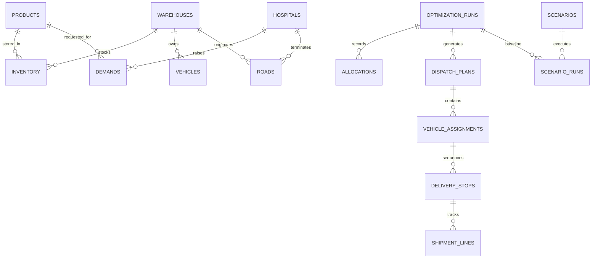
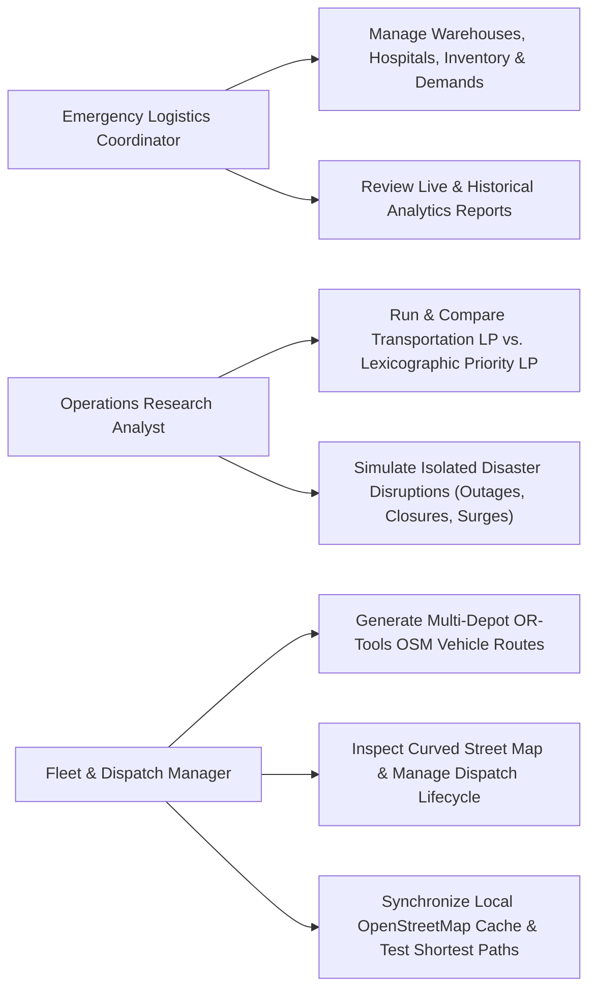

# MEDILOGIX — B.Tech Final-Year Project Report

**Emergency Medical Supply Distribution Optimization Using Operations Research and Intelligent Decision Support**

---

## 1. Title Page Information

- **Project Title**: MEDILOGIX — Emergency Medical Supply Distribution Optimization Using Operations Research and Intelligent Decision Support
- **Domain**: Operations Research (OR), Data Science & Supply Chain Management (DSCM), Full-Stack Software Engineering
- **Geographic Simulation Scope**: Pune Urban Area & Pimpri-Chinchwad, Maharashtra, India (`lat 18.40–18.70, lon 73.70–74.05`)
- **Primary Technologies**: Python 3.11+, FastAPI, SQLAlchemy 2.0, PuLP (COIN-OR CBC), Google OR-Tools, NetworkX, React 18 (Vite), Tailwind CSS, Recharts, React Leaflet, OpenStreetMap (`© OpenStreetMap contributors`, ODbL 1.0)
- **Institution / Student Details**: *(To be filled by the submitting student team prior to printing/binding)*

---

## 2. Abstract

Emergency medical supply distribution during urban disasters or demand surges involves competing pressures: limited stock across distribution hubs, critical-care hospitals requiring immediate prioritization, capacitated delivery fleets, and disrupted city road networks. **MEDILOGIX** is a full-stack web-based Operations Research decision-support platform designed and implemented for the Pune and Pimpri-Chinchwad metropolitan region. The system strictly decouples **supply allocation** from **physical vehicle routing**: Phase 3 solves Multi-Commodity Transportation Linear Programming and 4-Stage Sequential Lexicographic Priority Optimization via PuLP/CBC, while Phases 4–5 solve Multi-Depot Capacitated Vehicle Routing (CVRP) via Google OR-Tools over a locally cached directed OpenStreetMap (`NetworkX MultiDiGraph`) street network (`8,716` intersection nodes, `14,933` directed edges). On the reproducible synthetic baseline dataset (`RANDOM_SEED = 42`), lexicographic priority optimization raises Critical-priority hospital fulfillment from **91.68% to 100.00%** (`0` unmet units) and High-priority fulfillment from **89.32% to 98.71%** for a **7.06%** transportation cost increase (₹134,932.40 to ₹144,463.31). The platform further delivers persistent dispatch lifecycle management, isolated disaster scenario simulation (warehouse outages, corridor and OSM `way_id` closures, demand spikes, vehicle losses), an interactive curved-street React Leaflet map with graceful offline fallback, and unified live-versus-historical analytics, verified by **37/37 passing backend tests** and a clean production frontend build.

---

## 3. Introduction

Urban healthcare networks depend on timely replenishment of oxygen cylinders, IV fluids, trauma kits, and essential medicines. When supply chains experience shortages or road disruptions, ad-hoc manual coordination fails to balance clinical urgency against logistical feasibility. MEDILOGIX integrates Operations Research algorithms, spatial street-network analysis, relational persistence, and interactive visual analytics into a single modular web application.

---

## 4. Problem Statement

Given a network of medical distribution warehouses $I$ holding limited inventories $S_{i,k}$ of medical products $K$, hospitals $J$ classified into emergency priority tiers (`critical`, `high`, `normal`) requesting quantities $D_{j,k}$, a heterogeneous home-stationed vehicle fleet $V$ with weight capacities $Q_v$, and a directed urban road network $G=(N, E)$ subject to one-way rules, heavy-vehicle access restrictions, and road closures:

1. Determine optimal warehouse-to-hospital allocations $x_{i,j,k}$ and explicit shortages $u_{j,k}$ protecting higher-priority hospitals without arbitrary big-M weights.
2. Assign allocated shipments to available depot vehicles on closed multi-stop tours respecting payload capacities and 100% quantity conservation.
3. Compute realistic directed street paths using OpenStreetMap geometry with configurable objectives (minimum road distance or minimum estimated travel time) and offline fallback.
4. Enable isolated "what-if" disaster stress testing without mutating live operational data.

---

## 5. Motivation

Pure cost-minimizing transportation models systematically favor nearby lower-priority facilities during shortages, risking preventable stockouts at critical trauma centers. Meanwhile, academic OR implementations rarely connect mathematical solvers to persistent operational workflows, real street topology, or interactive decision-support interfaces. MEDILOGIX bridges this gap with engineering rigor and transparent modeling assumptions.

---

## 6. Objectives

1. Implement full CRUD management for warehouses, hospitals, medical inventory, and demand requests with foreign-key protection.
2. Formulate and compare Multi-Commodity Transportation LP and 4-Stage Lexicographic Priority LP using PuLP/CBC.
3. Integrate Google OR-Tools Multi-Depot CVRP with 1D weight capacities, split loads, multi-wave trips, and persistent dispatch lifecycle management.
4. Ingest, locally cache, and route over real Pune/PCMC OpenStreetMap directed road geometry with one-way, HGV access, OSM `way_id` closure, and offline synthetic fallback support.
5. Build an isolated Disaster Scenario Simulator and unified Analytics & Reports module with automated regression and end-to-end verification.

---

## 7. Scope

- **Included**: Pune Urban & Pimpri-Chinchwad (`18.40–18.70°N, 73.70–74.05°E`), 4 medical product categories, 3 fictional simulation warehouses, 8 synthetic hospital profiles, 6 fleet vehicles, 24 synthetic fallback corridors, locally cached Pune OSM arterial/collector road graph, 16-table relational database, REST API, and 10-page React SPA.
- **Explicitly Excluded / Disclaimed**: Live real-time traffic feeds, real-time GPS vehicle telemetry, proprietary hospital EHR data, 3D volumetric container packing, and automatic inventory stock deduction upon delivery confirmation.

---

## 8. Existing System

Conventional regional emergency supply coordination relies on spreadsheets, phone logs, or single-objective cost calculators that lack:
- Strict lexicographic priority guarantees under shortage;
- Automated LP-to-VRP conservation across capacitated vehicles;
- Directed urban street topology (one-way roads, truck restrictions, street closures);
- Isolated stress-testing sandboxes that preserve live operational records.

---

## 9. Proposed System

MEDILOGIX provides an end-to-end web decision-support system featuring:
- **Decoupled OR Pipeline**: PuLP/CBC allocation → Google OR-Tools Multi-Depot CVRP → NetworkX OSM directed shortest-path engine.
- **Immutable Auditability**: Every optimization run, dispatch plan, and disaster simulation is persisted as an inspectable historical record.
- **Real-World Spatial Grounding + Resilience**: Local OSM graph cache (`data/processed/pune_osm_road_graph.json`) with automatic synthetic corridor fallback whenever offline or uncached.

---

## 10. Technology Background & Conceptual Foundations

MEDILOGIX builds on well-established Operations Research and software engineering foundations:
- **Linear Programming & Transportation Problem**: Classical network-flow optimization solved via the simplex/branch-and-cut routines in COIN-OR CBC through PuLP.
- **Lexicographic Multi-Objective Optimization**: Sequential hierarchical optimization locking prior tier optimums to guarantee strict clinical priority ordering without arbitrary scalarization weights.
- **Capacitated Vehicle Routing Problem (CVRP)**: Combinatorial routing solved with Google OR-Tools (`PATH_CHEAPEST_ARC` + `GUIDED_LOCAL_SEARCH`).
- **Directed Graph Shortest Path**: Dijkstra's algorithm on a `NetworkX MultiDiGraph` constructed from OpenStreetMap Overpass JSON data (`ODbL 1.0`).
- **Modern Full-Stack Architecture**: FastAPI + Pydantic v2 + SQLAlchemy 2.0 on the backend; React 18 + Vite + Tailwind CSS + Recharts + React Leaflet on the frontend.

---

## 11. System Architecture

Full Mermaid architecture diagrams (Overall Architecture, Backend Request Lifecycle, LP-to-VRP Workflow, Isolated Scenario Simulation, and OSM Routing/Fallback) are documented in [system_architecture.md](system_architecture.md).

---

## 12. Data Flow

1. **Operational Input**: Users manage warehouses, hospitals, inventory, and demands via REST APIs validated by Pydantic v2 and persisted via SQLAlchemy 2.0.
2. **Allocation Flow**: `optimization_service.py` reads active facilities, net stock, actionable (`open` + `partially_fulfilled`) demands, and open corridors, executes PuLP/CBC, and persists immutable `OptimizationRun` + `Allocation` rows.
3. **Routing & Dispatch Flow**: `dispatch_service.py` reads a completed run's allocations, builds a directed OSM distance/time/geometry matrix via `road_network_service.py` (or activates `synthetic_fallback`), solves per-depot CVRP via `vehicle_routing.py`, and persists `DispatchPlan` → `VehicleAssignment` (including `route_geometry_json`) → `DeliveryStop` → `ShipmentLine`.
4. **Scenario Flow**: `scenario_service.py` copies baseline-scoped live state in memory, applies disruptions and isolated OSM `subgraph_view` closures, re-solves LP + VRP, computes baseline-vs-disrupted deltas, and persists an immutable `ScenarioRun`.
5. **Analytics Flow**: `analytics.py` aggregates current live operational tables separately from historical solver snapshots, persisted dispatch records, and scenario runs.

---

## 13. Database Design

MEDILOGIX uses 16 relational tables with strict foreign-key enforcement (`PRAGMA foreign_keys=ON` in SQLite; PostgreSQL-compatible SQLAlchemy models) and idempotent additive migrations (`backend/app/database/migrations.py`). Full table definitions are documented in [database_design.md](database_design.md).

---

## 14. ER Diagram

---

## 15. Use-Case Diagram

---

## 16. System Workflow

1. Initialize and seed database (`python -m app.database.init_db`).
2. Optionally cache Pune/PCMC OSM road network once (`python data/fetch_osm_network.py`).
3. Maintain facilities, inventory, and hospital demands.
4. Solve Transportation LP or 4-Stage Lexicographic Priority LP and compare trade-offs.
5. Generate multi-depot OR-Tools dispatch plan (Minimum Road Distance or Minimum Estimated Time), inspect curved OSM polylines on the interactive map, and track stop deliveries.
6. Stress-test resilience via isolated Disaster Scenario Simulations and inspect unified Analytics & Reports.

---

## 17–20. Operations Research Mathematical Formulation (Transportation LP, Lexicographic Priority LP & Multi-Depot CVRP)

Complete mathematical notation, sets, parameters, constraints, sequential locking bounds, OR-Tools integer scaling, and continuous LP integrality notes are presented in [mathematical_model.md](mathematical_model.md).

---

## 21. Disaster Simulation Methodology

Implemented in `backend/app/simulation/scenario_engine.py` and `backend/app/services/scenario_service.py`:
- Captures a read-only in-memory snapshot scoped identically to the selected baseline `OptimizationRun`.
- Applies any combination of: warehouse outages, synthetic corridor closures, OSM `closed_way_ids` closures (via read-only `nx.subgraph_view`), hospital demand spikes (`0%–300%`), and vehicle unavailability.
- Re-solves both LP allocation and OR-Tools CVRP, computes 11+ baseline-vs-disrupted deltas (including route distance and estimated duration shifts), and persists an immutable `ScenarioRun` with zero live database or cache mutation.

---

## 22. OpenStreetMap Integration

Implemented in `backend/app/optimization/osm_road_network.py`, `backend/app/services/road_network_service.py`, and `data/fetch_osm_network.py`:
- Downloads Pune & Pimpri-Chinchwad drivable arterial/collector streets (`motorway` through `tertiary` + `*_link`s) via Overpass API and caches locally under `data/processed/pune_osm_road_graph.json` (`~7.77 MB`).
- Live cached graph metrics: **`8,716` nodes**, **`14,933` directed edges**, **`8,517` one-way edges**, **`8,611` nodes in largest SCC (`98.8%`)**, **`11/11` active facilities snapped** (`3.5 m – 275 m`).
- Enforces one-way rules, medical-truck (`hgv`) access limits, and OSM `way_id` road closures.
- Automatically falls back to `synthetic_fallback` if the cache is missing or fails `validate_osm_graph()`.
- Full technical specification in [phase5_osm_routing_integration.md](phase5_osm_routing_integration.md).

---

## 23. Technology Stack

| Layer | Technologies |
| :--- | :--- |
| **Frontend** | React 18, Vite 5, Tailwind CSS 3, React Router 6, Axios, Lucide React, Recharts, React Leaflet + Leaflet |
| **Backend** | Python 3.11, FastAPI, Uvicorn, Pydantic v2, SQLAlchemy 2.0 |
| **OR & GIS** | PuLP (COIN-OR CBC), Google OR-Tools (`pywrapcp`), NetworkX (`MultiDiGraph`), Pandas, NumPy |
| **Database** | SQLite (development), PostgreSQL-compatible SQLAlchemy ORM (`psycopg2-binary`) |
| **Testing** | Pytest, FastAPI `TestClient`, HTTPX |

---

## 24. Module Descriptions

1. **Dashboard** (`Dashboard.jsx`) — Live operational KPIs, latest run snapshot, Pune network map, recent runs.
2. **Warehouses** (`Warehouses.jsx`) — Searchable/sortable warehouse CRUD with capacity validation and FK deletion protection.
3. **Hospitals** (`Hospitals.jsx`) — Hospital CRUD with priority filtering and emergency priority escalation.
4. **Inventory** (`Inventory.jsx`) — Grouped & tabular warehouse stock views, low-stock alerts, stock adjustment modals.
5. **Demand Requests** (`Demands.jsx`) — Actionable/fulfilled demand management with priority & status filters.
6. **Optimization Workbench** (`Optimization.jsx`) — Scope selector, Transportation LP, Lexicographic Priority LP, Compare Mode, Run History, 5 Recharts visualizations, Academic Formulation panel.
7. **Delivery Routes & Dispatch** (`Routes.jsx`, `RoadNetworkPanel.jsx`, `PuneNetworkMap.jsx`) — Routing objective selector (`min_distance`/`min_time`), optional closed OSM way IDs, dispatch lifecycle controls, Canvas-accelerated curved OSM map with layer/vehicle/priority filters, and OSM Road Network Management & Shortest-Path Explorer.
8. **Disaster Scenario Simulator** (`Scenarios.jsx`) — 5 disruption modes (including OSM `way_id` closures), side-by-side comparison cards & charts, disruption map, simulation history.
9. **Analytics & Reports** (`Analytics.jsx`) — 4 tabbed KPI suites (Live Supply Chain, Historical Optimization Snapshot, Dispatch & Fleet, Disaster Scenarios) and 8 dynamic Recharts visualizations.
10. **Settings** (`Settings.jsx`) — Live backend/DB connectivity, geographic bounds, OSM cache diagnostics, solver stack summary, and integrity statement.

---

## 25. API Documentation Summary

Complete endpoint specifications and example JSON payloads are maintained in [api_documentation.md](api_documentation.md) and served interactively via FastAPI Swagger UI at `http://127.0.0.1:8000/docs`.

---

## 26. Testing Methodology

- **Isolated In-Memory SQLite Fixtures**: Every backend API test spins up a clean SQLite database with `PRAGMA foreign_keys=ON` seeded from `data/synthetic/*.csv`, leaving `backend/medilogix_dev.db` untouched.
- **Deterministic Mocked OSM Graphs**: Phase 5A and 5B tests validate OSM parsing, one-way rules, HGV access restrictions, `min_distance` vs. `min_time` objectives, closed-way rerouting, unreachable hospitals, missing/corrupted cache fallback, geometry persistence, and scenario isolation without external Overpass calls.
- **Mathematical & Conservation Audits**: Automated tests assert warehouse stock ceilings, hospital demand balance, lexicographic stage locking, split-load & multi-wave conservation, lifecycle state machine enforcement, and exact Analytics KPI consistency.

---

## 27. Actual Test Results

- **Backend Automated Test Suite** (`backend\.venv\Scripts\pytest.exe -v`):
  - **Total Collected**: `37`
  - **Passed**: **`37` (100%)**
  - **Failed**: `0`
  - **Skipped**: `0`
  - **Duration**: `21.14s`
- **Frontend Production Build** (`npm run build` in `frontend/`):
  - **Status**: **Succeeded** (`2,306` modules compiled cleanly via Vite in `17.19s`).

---

## 28. Experimental Results

### A. Reproducible Synthetic Baseline (`RANDOM_SEED = 42`, `2,611` units demand, `2,422` units allocated)

| Model | Solver Status | Transport Cost (INR) | Critical Fulfillment (913 req.) | High Fulfillment (1,011 req.) | Normal Fulfillment (687 req.) |
| :--- | :---: | :---: | :---: | :---: | :---: |
| **Transportation LP** | `Optimal` | ₹134,932.40 | 91.68% (`76` unmet) | 89.32% (`108` unmet) | 99.27% (`5` unmet) |
| **4-Stage Lexicographic Priority LP** | `Optimal` | ₹144,463.31 (+7.06%) | **100.00% (`0` unmet)** | **98.71% (`13` unmet)** | 74.38% (`176` unmet) |

### B. Live Pune/PCMC OpenStreetMap Vehicle Routing Verification (Latest Live DB Optimal Run, `18,421.0 kg` total payload)

| Routing Configuration | Routing Source | Status | Routes / Stops | Total Distance | Est. Travel Time | LP Conservation & Capacity |
| :--- | :---: | :---: | :---: | :---: | :---: | :---: |
| **OSM Minimum Distance** | `osm` | `Optimal` | `8` tours / `11` stops | **164.25 km** | 326.5 min | 100% conserved · 0 violations (`920` pts on Route 1) |
| **OSM Minimum Est. Time** | `osm` | `Optimal` | `8` tours / `11` stops | 168.18 km | **311.6 min (−14.9 min)** | 100% conserved · 0 violations (`869` pts on Route 1) |
| **OSM Way Closure (`way_id=641670810`)** | `osm` | `Optimal` | `8` tours / `11` stops | 165.99 km (+1.74 km) | Rerouted cleanly | Closed way strictly excluded (`still_used=False`) |
| **Missing Cache Fallback** | `synthetic_fallback` | `Optimal` | `8` tours / `11` stops | 153.54 km | Synthetic est. | Explicit `fallback_warning` returned |

---

## 29. Screenshots Checklist for Submission Binding

Capture and insert high-resolution screenshots of:
1. Emergency Command Dashboard (`/`) showing Live KPIs and Pune Network Map.
2. Warehouses & Hospitals CRUD modals (`/warehouses`, `/hospitals`).
3. Optimization Comparison view (`/optimization`) showing Transportation LP vs. Lexicographic Priority LP charts.
4. Delivery Routes — Vehicle Assignments & Stops (`/routes`) with Routing Objective selector and OSM badge.
5. Delivery Routes — Interactive Curved OSM Street Map with layer filters & vehicle route popup.
6. Delivery Routes — Road Network & Corridors tab showing `8,716` OSM nodes, facility snapping pills, and Shortest-Path Explorer.
7. Disaster Scenario Simulator (`/scenarios`) showing Baseline vs. Disrupted impact cards and disruption map.
8. Analytics & Reports (`/analytics`) across Supply Chain, Optimization, Dispatch, and Scenarios tabs.

---

## 30. Limitations

1. **No Live Traffic Integration or GPS Tracking**: Road geometry is sourced from OpenStreetMap (`© OpenStreetMap contributors`, ODbL 1.0), whereas travel times are estimated using assumed road-class speed profiles and do not represent live congestion, signal delays, or real-time vehicle GPS telemetry.
2. **Synthetic Operational Data**: Warehouse inventories, hospital demands, and vehicle fleet parameters are illustrative synthetic data for academic demonstration and are not connected to live hospital or emergency dispatch systems.
3. **1D Weight Capacity Only**: Vehicle payloads enforce weight (`kg`) only; cubic volume and cold-chain compartment constraints are not modeled.
4. **No Delivery Time-Window Optimization**: VRPTW deadline constraints are not implemented.
5. **No Automatic Inventory Reconciliation After Delivery**: Marking stops `delivered` updates `shipment_lines` without auto-deducting warehouse `inventory`.
6. **Local OSM Cache Freshness & Facility Snapping**: The cached Pune/PCMC OSM road graph (`data/processed/pune_osm_road_graph.json`) is static until manually synchronized; newly created facilities outside cached bounds or snap radius require road-network synchronization or snapping verification.
7. **Continuous LP Variables**: Adding arbitrary multi-commodity side constraints does not universally guarantee integer-valued LP solutions.

---

## 31. Future Scope

- Vehicle Routing with Time Windows (VRPTW) prioritizing Critical hospital delivery windows.
- Multi-dimensional truck loading (weight + cubic volume + cold-chain segregation).
- Automated reservation/deduction inventory reconciliation workflows upon confirmed delivery.
- Demand forecasting models and multi-period rolling-horizon emergency restocking.
- District-wide Pune expansion via `.env` bounding-box configuration and PostgreSQL production deployment.

---

## 32. Conclusion

MEDILOGIX successfully demonstrates how formal Operations Research models (**PuLP CBC** Transportation & 4-Stage Lexicographic Priority LP), industrial vehicle routing (**Google OR-Tools CVRP**), and real-world urban street topology (**OpenStreetMap + NetworkX MultiDiGraph**) can be unified inside an auditable, resilient, full-stack decision-support web platform. With **37/37 passing backend tests**, a verified production React build, preserved historical data, and transparent academic documentation, the system is ready for live demonstration and B.Tech submission.

---

## 33. References & Data Attribution

1. **OpenStreetMap**: Map tiles, road network geometry, and street metadata © OpenStreetMap contributors, licensed under the **Open Database License (ODbL 1.0)** — https://www.openstreetmap.org/copyright
2. **Overpass API**: Read-only OpenStreetMap query interface — https://overpass-api.de/
3. **PuLP & COIN-OR CBC**: Linear Programming modeling library and open-source solver — https://coin-or.github.io/pulp/
4. **Google OR-Tools**: Combinatorial optimization & Vehicle Routing library — https://developers.google.com/optimization/routing
5. **NetworkX**: Python graph algorithms library — https://networkx.org/
6. **FastAPI, SQLAlchemy, React, Recharts, Leaflet**: Official framework documentation for the implemented full-stack platform.
