# Optimization of Emergency Medical Supply Chains Under Severe Disruption: A Decoupled Lexicographic Linear Programming and Capacitated Vehicle Routing Approach with OpenStreetMap GIS Integration

**Author:** Vishal Kimbahune  
**Affiliation:** Department of Artificial Intelligence and Data Science  
**Target Publication Venues:** *IEEE Transactions on Intelligent Transportation Systems*, *Elsevier Computers & Operations Research*, *Socio-Economic Planning Sciences (Special Issue on Healthcare Operations)*, or *IEEE Access*  
**Keywords:** Emergency Medical Logistics, Operations Research, Lexicographic Goal Programming, Capacitated Vehicle Routing Problem (CVRP), OpenStreetMap (OSM), NetworkX, Disaster Resilience, Decision Support Systems

---

## Abstract

During public health emergencies, epidemiological outbreaks, and natural catastrophes, regional healthcare supply chains experience acute structural stress: finite centralized medical inventory, asymmetric hospital urgency, strict vehicle payload limitations, and urban road network disruptions. Traditional commercial distribution models optimize purely for monetary transportation expenditure, systematically starving geographically distant emergency trauma centers under inventory scarcity. This paper presents **MEDILOGIX**, a comprehensive, mathematically grounded decision-support framework that models emergency medical supply distribution as a dual-phase, decoupled optimization problem. In the strategic allocation phase, a **4-Stage Sequential Lexicographic Priority Linear Program** is formulated to eliminate arbitrary penalty weighting and guarantee lexicographic triage dominance ($\text{Critical Tier 1} \rightarrow \text{High Tier 2} \rightarrow \text{Normal Tier 3} \rightarrow \text{Transportation Cost}$). In the tactical dispatch phase, solved allocations are directly ingested by a multi-depot **Google OR-Tools Capacitated Vehicle Routing Problem (CVRP)** engine executing over a directed **OpenStreetMap (OSM)** road network graph ($\mathcal{G} = (V, E)$, $|V| = 8,716$, $|E| = 14,933$) via **NetworkX** Dijkstra algorithms, enforcing physical one-way restrictions, heavy-vehicle delivery access rules, and automated capacity-feasible load splitting. 

Evaluated on an empirical benchmark of the Pune Urban Area and Pimpri-Chinchwad (PCMC), Maharashtra, India ($2,611$ demand units across four medical commodities under a $7.24\%$ systemic inventory deficit), the lexicographic formulation achieves **$100.00\%$ Critical Tier fulfillment** (eliminating all $76$ critical unmet units) and **$98.71\%$ High-priority fulfillment** for a marginal **$7.06\%$ ($+\text{INR } 9,530.91$)** cost increment compared to cost-only linear programming. The routing engine satisfies $100\%$ LP-to-VRP quantity conservation across $8$ vehicle tours with zero payload violations. Furthermore, a non-destructive in-memory perturbation engine evaluates facility outages, road cuts, and demand surges without operational database mutation. Finally, an enterprise role-based governance architecture (Admin, Hospital, Warehouse, Delivery) ensures verifiable end-to-end auditability. This paper provides the complete mathematical formulations, algorithmic pseudocode, empirical validation data, managerial insights, and an academic roadmap for publication.

---

## 1. Introduction

### 1.1 Background and Practical Motivation
Modern supply chain management prioritizes lean inventories, just-in-time replenishment, and cost minimization. While economically efficient under steady-state operating environments, this paradigm collapses under sudden disaster events, epidemics, or mass-casualty incidents. During the 2020–2022 respiratory health emergencies in metropolitan India (such as the oxygen distribution crisis in the Pune and Pimpri-Chinchwad municipal regions), logistics controllers encountered severe operational bottlenecks:
1. **Finite, Inelastic Supply**: Regional medical depots held constrained quantities of life-saving medical supplies (gaseous/liquid oxygen cylinders, IV fluid cartons, surgical trauma kits, and emergency antibiotic boxes).
2. **Asymmetric Clinical Priority**: Stockouts at tertiary intensive care units (ICUs) and civic trauma centers carried immediate mortality risk, whereas delayed replenishment at suburban outpatient clinics incurred minor clinical disruption.
3. **The Perverse Incentive of Cost Optimization**: Conventional transportation linear programming models prioritize delivery routes with the lowest per-unit transportation cost. Under supply shortages, these algorithms systematically allocate available supplies to proximate low-priority clinics while leaving peripheral trauma facilities completely unserved.
4. **Physical Fleet Constraints**: Supplies must be physically transported by a heterogeneous fleet of utility vehicles with strict gross vehicle weight (GVW) limits, requiring complex multi-stop routing and vehicle wave reuse.
5. **Urban Network Disruptions**: Monsoonal flooding, infrastructural collapses, bridge closures, and urban traffic restrictions (e.g., one-way street rules and heavy goods vehicle bans) frequently invalidate idealized Euclidean distance approximations.

### 1.2 Research Gap
Existing literature in disaster relief operations typically exhibits one of three fundamental shortcomings:
- **Heuristic or Single-Commodity Focus**: Many emergency routing models consider only a single homogeneous resource (e.g., relief food or clean water), ignoring multi-commodity weight profiles, distinct packaging metrics, and handling restrictions.
- **Arbitrary Penalty Weights in Multi-Objective Optimization**: Standard formulations combine shortage penalties and monetary costs into a single objective function ($Z = \sum c_{ij} x_{ij} + M \sum u_j$). Selecting the penalty coefficient $M$ is notoriously difficult: if $M$ is too low, critical demands are abandoned for cost savings; if $M$ is too high, numerical solver instability and round-off errors occur.
- **Decoupling Disconnect with GIS Geometry**: Academic models frequently evaluate vehicle routing problems on synthetic random customer coordinates using Euclidean or Manhattan distances, failing to reflect the physical reality of directed urban road networks where one-way streets, turn bans, and highway classes determine true travel durations.

### 1.3 Key Contributions
This paper addresses these gaps through the design, implementation, and empirical validation of **MEDILOGIX**. The specific research and engineering contributions are:
1. **Hierarchical Lexicographic Optimization Model**: Formulates a 4-stage sequential lexicographic linear program that mathematically guarantees priority dominance ($\text{Critical} \succ \text{High} \succ \text{Normal} \succ \text{Cost}$) without arbitrary penalty tuning, locking the Pareto-optimal shortfall fraction at each tier before cost optimization.
2. **Decoupled Mathematical Conservation (LP to CVRP)**: Develops an operational pipeline that passes solved multi-commodity allocations directly into a multi-depot Capacitated Vehicle Routing Problem (Google OR-Tools) with automated load splitting and a proven $100\%$ quantity conservation law.
3. **Directed OpenStreetMap Spatial Integration**: Extracts, caches, and navigates a directed topological graph ($\mathcal{G} = (V, E)$, $|V| = 8,716$, $|E| = 14,933$) of the Pune and PCMC metropolitan area, enabling dual-objective routing (Minimum Distance vs. Minimum Estimated Travel Time) over realistic street geometries.
4. **Non-Destructive In-Memory Disaster Simulation**: Develops an isolated perturbation framework to quantify the resilience impact of facility outages, road closures, and localized demand surges without altering operational relational records.
5. **Full-Stack Enterprise Implementation and Governance**: Implements the architecture as an end-to-end platform featuring four purpose-built portals (Admin, Hospital, Warehouse, Delivery), cryptographic Argon2id authentication, rotating HTTP-only refresh tokens, and append-only audit logging.

---

## 2. Literature Review and Theoretical Foundation

### 2.1 Humanitarian Supply Chain Management
Humanitarian logistics research focuses on the rapid, equitable acquisition and distribution of vital resources during crises (Holguín-Veras et al., 2012; Sheu, 2007). Balcik et al. (2008) observed that standard commercial distribution metrics (e.g., profit maximization, cost minimization) are fundamentally mismatched with emergency relief, where social welfare, human life preservation, and stockout avoidance dominate. Unlike commercial supply chains where demand can be backlogged, stockouts in emergency medical supply chains directly induce human mortality.

### 2.2 Priority-Based and Multi-Criteria Allocation
Multi-criteria optimization in resource-constrained environments traces back to Goal Programming (Charnes & Cooper, 1961; Ignizio, 1976). When competing objectives possess a natural, non-negotiable hierarchy, **Lexicographic Goal Programming (LGP)** provides a mathematically rigorous solution (Romero, 1991; Tamiz et al., 1998). In healthcare, patient triage systems (e.g., Emergency Severity Index, Manchester Triage System) categorize urgency deterministically. Translating triage concepts into supply chain optimization requires that higher-priority tiers achieve absolute priority over lower tiers, a structure perfectly suited for sequential lexicographic optimization.

### 2.3 Capacitated Vehicle Routing Problems (CVRP) in Crisis Response
The Vehicle Routing Problem (VRP) is an NP-hard combinatorial optimization problem that determines the optimal set of routes for a fleet of vehicles delivering goods to customers (Dantzig & Ramser, 1959; Toth & Vigo, 2014). In disaster scenarios, Capacitated VRP (CVRP) models incorporate finite vehicle payload capacities ($Q_v$), multi-depot origins, and split deliveries (Archetti & Speranza, 2012). While integrated location-allocation-routing models exist, they present extreme computational complexity ($\mathcal{NP}$-hard in the strong sense), rendering real-time re-optimization impossible during sudden operational shifts. Decoupling the continuous allocation problem from the combinatorial vehicle routing problem provides computational tractability while preserving operational optimality.

### 2.4 Spatial Network Analysis and OpenStreetMap GIS
Traditional operations research literature frequently computes travel costs via the Haversine great-circle formula or Euclidean metric multiplied by an empirical tortuosity coefficient (typically $1.20 - 1.35$). However, urban road networks exhibit heavy topological constraints: physical barriers (rivers, railways), one-way road networks, and vehicle class access bans. OpenStreetMap (OSM) provides open, topologically connected spatial data (Haklay & Weber, 2008). Applying directed graph algorithms (e.g., Dijkstra, $A^*$) to OSM vector representations yields true driving distances and speed-profiled travel times, bridging theoretical optimization with physical transport reality.

---

## 3. Mathematical Modeling and Problem Formulation

### 3.1 Notation, Sets, and Parameters

#### Sets and Indices
- $I$: Set of operational medical logistics warehouses (depots), indexed by $i \in I$.
- $J$: Set of acute-care healthcare facilities (hospitals), indexed by $j \in J$.
- $J_{\text{crit}}, J_{\text{high}}, J_{\text{norm}} \subset J$: Mutually exclusive partition of hospitals by clinical emergency priority tier:
  $$J = J_{\text{crit}} \cup J_{\text{high}} \cup J_{\text{norm}}, \quad J_a \cap J_b = \emptyset \; \forall a \ne b$$
- $K$: Set of essential medical commodities, indexed by $k \in K$ ($\text{PROD-01: Oxygen}$, $\text{PROD-02: IV Fluids}$, $\text{PROD-03: Trauma Kits}$, $\text{PROD-04: Essential Medicines}$).
- $A \subseteq I \times J$: Set of active, traversable transportation corridors connecting warehouse $i$ to hospital $j$.
- $V_i$: Fleet of delivery vehicles stationed at warehouse depot $i \in I$, indexed by $v \in V_i$.
- $\mathcal{G} = (V_{\text{OSM}}, E_{\text{OSM}})$: Directed spatial road network graph extracted from OpenStreetMap.

#### Parameters
- $S_{ik} \ge 0$: Available physical net inventory of medical product $k$ at warehouse $i$.
- $D_{jk} \ge 0$: Requested quantity of product $k$ by hospital $j$.
- $w_k > 0$: Unit mass (weight) of medical product $k$ in kilograms ($\text{kg}$).
- $C_{ijk} \ge 0$: Unit transportation cost of shipping one unit of commodity $k$ from warehouse $i$ to hospital $j$:
  $$C_{ijk} = \text{base\_cost}_{ij} + \left( \text{distance\_km}_{ij} \times \text{unit\_cost\_per\_km}_k \right)$$
- $Q_v > 0$: Maximum rated payload capacity of vehicle $v$ in kilograms ($\text{kg}$).
- $A_{ij} \in \{0, 1\}$: Corridor availability parameter ($1$ if road link $(i,j)$ is open and traversable, $0$ if blocked).
- $\varepsilon = 10^{-8}$: Numerical tolerance threshold preventing solver round-off instability.

#### Decision Variables
- $x_{ijk} \ge 0$: Continuous variable representing the quantity of medical product $k$ allocated and transported from warehouse $i$ to hospital $j$.
- $u_{jk} \ge 0$: Continuous variable representing the unfulfilled demand (shortage) of product $k$ at hospital $j$.
- $y_{abv} \in \{0, 1\}$: Binary routing variable equal to $1$ if vehicle $v$ travels directly from stop $a$ to stop $b$, and $0$ otherwise.
- $q_{sk} \ge 0$: Quantity of product $k$ delivered to stop $s$ on a vehicle route.

---

### 3.2 Model A: Multi-Commodity Cost-Minimization Transportation LP

Model A serves as the baseline economic benchmark. It minimizes aggregate logistics cost while penalizing unfulfilled demand through a uniform shortage penalty:

$$\min_{x, u} \quad Z_{\text{cost}} = \sum_{(i,j) \in A} \sum_{k \in K} C_{ijk} \, x_{ijk} + M \sum_{j \in J} \sum_{k \in K} u_{jk}$$

Subject to:

$$\sum_{j \in J : (i,j) \in A} x_{ijk} \le S_{ik} \quad \forall i \in I, \; \forall k \in K \quad \text{(Warehouse Inventory Limit)}$$

$$\sum_{i \in I : (i,j) \in A} x_{ijk} + u_{jk} = D_{jk} \quad \forall j \in J, \; \forall k \in K \quad \text{(Demand Conservation)}$$

$$x_{ijk} = 0 \quad \forall (i,j) \notin A, \; \forall k \in K \quad \text{(Closed Corridor Enforcement)}$$

$$x_{ijk} \ge 0, \quad u_{jk} \ge 0 \quad \forall i \in I, \; \forall j \in J, \; \forall k \in K \quad \text{(Non-Negativity)}$$

*Theoretical Critique of Model A*: When systemic supply is insufficient ($\sum_i S_{ik} < \sum_j D_{jk}$), Model A treats all shortages $u_{jk}$ equally. Consequently, to minimize $\sum C_{ijk} x_{ijk}$, the solver fulfills demand at hospitals located geographically closer to depots (low $C_{ijk}$) and sacrifices distant hospitals, regardless of whether the distant hospital is an intensive care facility ($j \in J_{\text{crit}}$).

---

### 3.3 Model B: Sequential 4-Stage Lexicographic Priority Optimization

To resolve the triage failure of Model A, MEDILOGIX defines a normalized shortfall fraction for each priority tier. Let total demand for priority tier $P \in \{\text{crit}, \text{high}, \text{norm}\}$ be:

$$D_P = \sum_{j \in J_P} \sum_{k \in K} D_{jk}$$

Assuming $D_P > 0$, the normalized tier shortfall fraction $F_P \in [0, 1]$ is:

$$F_P = \frac{\sum_{j \in J_P} \sum_{k \in K} u_{jk}}{D_P}$$

If $D_P = 0$, the stage is logged as skipped with $F_P^* = 0$.

```
+---------------------------------------------------------------------------------+
|                   4-STAGE SEQUENTIAL LEXICOGRAPHIC PIPELINE                     |
+---------------------------------------------------------------------------------+
|                                                                                 |
|  [STAGE 1]  Minimize Critical Tier Shortfall:                                   |
|             min F_crit ===> F_crit*                                             |
|                                                                                 |
|  [STAGE 2]  Minimize High-Priority Shortfall:                                   |
|             min F_high   s.t.  F_crit <= F_crit* + eps ===> F_high*             |
|                                                                                 |
|  [STAGE 3]  Minimize Normal-Priority Shortfall:                                 |
|             min F_norm   s.t.  F_crit <= F_crit* + eps                          |
|                                F_high <= F_high* + eps ===> F_norm*             |
|                                                                                 |
|  [STAGE 4]  Minimize Monetary Logistics Cost:                                   |
|             min Transport Cost                                                  |
|             s.t.  F_crit <= F_crit* + eps                                       |
|                   F_high <= F_high* + eps                                       |
|                   F_norm <= F_norm* + eps                                       |
|                                                                                 |
+---------------------------------------------------------------------------------+
```

#### Stage-by-Stage Formulation:

- **Stage 1 (Critical Triage Minimization)**:
  $$\min \quad F_{\text{crit}} = \frac{\sum_{j \in J_{\text{crit}}} \sum_{k \in K} u_{jk}}{D_{\text{crit}}}$$
  $$\text{Subject to constraints (2), (3), (4), (5). Solved to optimality } \implies F_{\text{crit}}^*$$

- **Stage 2 (High-Priority Triage Minimization)**:
  $$\min \quad F_{\text{high}} = \frac{\sum_{j \in J_{\text{high}}} \sum_{k \in K} u_{jk}}{D_{\text{high}}}$$
  $$\text{Subject to constraints (2), (3), (4), (5), and:}$$
  $$F_{\text{crit}} \le \text{bound}(F_{\text{crit}}^*) \quad \text{where } \text{bound}(f^*) = \begin{cases} 0 & \text{if } f^* \le 10^{-9} \\ f^* + 10^{-8} & \text{otherwise} \end{cases}$$
  $$\text{Solved to optimality } \implies F_{\text{high}}^*$$

- **Stage 3 (Normal-Priority Triage Minimization)**:
  $$\min \quad F_{\text{norm}} = \frac{\sum_{j \in J_{\text{norm}}} \sum_{k \in K} u_{jk}}{D_{\text{norm}}}$$
  $$\text{Subject to constraints (2), (3), (4), (5), and:}$$
  $$F_{\text{crit}} \le \text{bound}(F_{\text{crit}}^*), \quad F_{\text{high}} \le \text{bound}(F_{\text{high}}^*)$$
  $$\text{Solved to optimality } \implies F_{\text{norm}}^*$$

- **Stage 4 (Transportation Cost Optimization Subject to Locked Tiers)**:
  $$\min \quad Z_{\text{transport}} = \sum_{(i,j) \in A} \sum_{k \in K} C_{ijk} \, x_{ijk}$$
  $$\text{Subject to constraints (2), (3), (4), (5), and:}$$
  $$F_{\text{crit}} \le \text{bound}(F_{\text{crit}}^*), \quad F_{\text{high}} \le \text{bound}(F_{\text{high}}^*), \quad F_{\text{norm}} \le \text{bound}(F_{\text{norm}}^*)$$

#### Theoretical Properties of Model B:
- **Theorem 1 (Absolute Priority Dominance)**: No allocation trade-off can improve Normal or High fulfillment by increasing Critical unmet demand by even $\delta > 0$ units.
- **Theorem 2 (Shortage Invariance)**: Total unmet demand across all tiers is strictly bounded by systemic supply capacity:
  $$\sum_{j \in J} \sum_{k \in K} u_{jk}^* \ge \max\left(0, \; \sum_{j \in J} \sum_{k \in K} D_{jk} - \sum_{i \in I} \sum_{k \in K} S_{ik}\right)$$
- **Theorem 3 (Deterministic Reproducibility)**: Under fixed parameter bounds and solver seeds, the sequential linear programming formulation guarantees a unique optimal Pareto frontier.

---

### 3.4 Model C: Multi-Depot Capacitated Vehicle Routing Problem (CVRP)

Once allocations $x_{ijk}^*$ are determined, they are decoupled from the continuous LP and handed over to the vehicle routing engine. The system solves an independent CVRP for each warehouse depot $i \in I$.

For depot $i$, let $S_i$ be the set of delivery stops, where node $0$ denotes the depot. The distance or time cost between stops $a$ and $b$ is given by $c(a, b)$, derived from the OpenStreetMap road network.

$$\min_{y, z} \quad \sum_{v \in V_i} \sum_{a \in \{0\} \cup S_i} \sum_{b \in \{0\} \cup S_i} c(a, b) \, y_{abv} + F_{\text{fixed}} \sum_{v \in V_i} z_v$$

Subject to:

$$\sum_{v \in V_i} \sum_{a \in \{0\} \cup S_i, a \ne b} y_{abv} = 1 \quad \forall b \in S_i \quad \text{(Each stop visited exactly once)}$$

$$\sum_{b \in S_i} y_{0bv} = z_v \le 1 \quad \forall v \in V_i \quad \text{(Vehicle departure from depot)}$$

$$\sum_{a \in S_i} y_{a0v} = z_v \le 1 \quad \forall v \in V_i \quad \text{(Vehicle return to depot)}$$

$$\sum_{a \in \{0\} \cup S_i} y_{apv} - \sum_{b \in \{0\} \cup S_i} y_{pbv} = 0 \quad \forall p \in S_i, \; \forall v \in V_i \quad \text{(Flow Conservation)}$$

$$\sum_{s \in \text{tour}(v)} \sum_{k \in K} w_k \, q_{sk} \le Q_v \, z_v \quad \forall v \in V_i \quad \text{(Vehicle Weight Payload Limit)}$$

$$u_a - u_b + |S_i| \, y_{abv} \le |S_i| - 1 \quad \forall a, b \in S_i, a \ne b \quad \text{(Miller-Tucker-Zemlin Subtour Elimination)}$$

#### Automated Load Splitting Algorithm:
If a hospital's allocated consignment mass $\Omega_j = \sum_{k \in K} w_k x_{ijk}^*$ exceeds the maximum payload capacity of any available vehicle ($\Omega_j > \max_{v} Q_v$), the consignment is automatically partitioned into $M_j = \lceil \Omega_j / Q_{\max} \rceil$ child delivery stops:
$$q_{s_m, k} = \frac{x_{ijk}^*}{M_j} \quad \text{such that} \quad \sum_{m=1}^{M_j} q_{s_m, k} = x_{ijk}^* \quad \forall k \in K$$

#### Quantity Conservation Law:
$$\sum_{v \in V_i} \sum_{s \in S_i(j)} q_{sk} = x_{ijk}^* \quad \forall j \in J, \; \forall k \in K \quad \text{(100\% LP-to-VRP Conservation)}$$

---

### 3.5 Model D: Directed Road Network Shortest Paths via OpenStreetMap

The cost matrix $c(a, b)$ is not computed via synthetic straight lines. Instead, it is computed over a directed graph $\mathcal{G} = (V_{\text{OSM}}, E_{\text{OSM}})$ extracted directly from OpenStreetMap:

$$\text{cost}(a, b) = \min_{P_{ab}} \sum_{e \in P_{ab}} \text{weight}(e)$$

Where edge weights are defined based on the chosen operational objective:
- **Minimum Distance Mode (`min_distance`)**:
  $$\text{weight}(e) = \text{length\_meters}(e)$$
- **Minimum Travel Time Mode (`min_time`)**:
  $$\text{weight}(e) = \frac{\text{length\_meters}(e)}{\text{speed\_mps}(e)}$$

Where $\text{speed\_mps}(e)$ is derived from official OpenStreetMap highway classifications:
- Motorway: $60 \text{ km/h}$ ($16.67 \text{ m/s}$)
- Trunk: $50 \text{ km/h}$ ($13.89 \text{ m/s}$)
- Primary Arterial: $40 \text{ km/h}$ ($11.11 \text{ m/s}$)
- Secondary Arterial: $32 \text{ km/h}$ ($8.89 \text{ m/s}$)
- Tertiary Connector: $25 \text{ km/h}$ ($6.94 \text{ m/s}$)
- Residential / Service: $20 \text{ km/h}$ ($5.56 \text{ m/s}$)

One-way attributes (`oneway=yes`) enforce directed edge traversal ($u \rightarrow v \in E_{\text{OSM}}, v \rightarrow u \notin E_{\text{OSM}}$).

---

## 4. Software Architecture and Implementation

### 4.1 Modular Component Pipeline
MEDILOGIX is constructed as a decoupled, four-tier architecture:

```mermaid
flowchart LR
    subgraph Frontend["React 18 + Vite Presentation Layer"]
        P_Admin["Admin Portal"]
        P_Hosp["Hospital Portal"]
        P_WH["Warehouse Portal"]
        P_Deliv["Delivery Portal"]
    end

    subgraph Gateway["FastAPI REST API Gateway"]
        Auth["Argon2id + JWT Security"]
        Deps["RBAC Route Dependencies"]
    end

    subgraph Domain["Application & Domain Services"]
        OptSvc["Optimization Service"]
        DispSvc["Dispatch Service"]
        RoadSvc["NetworkX Road Service"]
        SimSvc["Scenario Service"]
    end

    subgraph CoreOR["Operations Research Solvers"]
        PuLP["PuLP (COIN-OR CBC LP)"]
        ORTools["Google OR-Tools (CVRP)"]
        NX["NetworkX Dijkstra"]
    end

    subgraph Data["Persistence Layer"]
        RelDB[(SQLite / PostgreSQL)]
        OSMCache[("pune_osm_road_graph.json")]
    end

    Frontend --> Gateway
    Gateway --> Domain
    Domain --> CoreOR
    Domain --> Data
    CoreOR --> OSMCache
```



### 4.2 Security and Governance Architecture
- **Password Security**: Implements the **Argon2id** password hashing algorithm (via `argon2-cffi`), which is memory-hard and cryptographically superior to legacy bcrypt or PBKDF2.
- **Authentication**: Uses short-lived **HS256 JWT access tokens** (stored exclusively in client memory) paired with **cryptographically secure 256-bit HTTP-only refresh cookies** (`SameSite=Lax`, path-scoped to `/api/auth`).
- **Audit Logging**: An immutable, append-only `audit_logs` table records every operational state change (order submission, administrative approval, dispatch generation, delivery confirmation) with recursive key redaction of sensitive credentials.
- **Last-Admin Governance Guard**: The backend enforces that the final active administrator account cannot be deactivated, demoted, or deleted.

---

## 5. Empirical Results and Discussion

### 5.1 Experimental Setup and Geographic Context
The experimental evaluation is conducted on a representative urban benchmark of the **Pune Urban Area and Pimpri-Chinchwad Municipal Corporation (PCMC)** in Maharashtra, India.
- **Spatial Bounds**: Latitudes $18.40^\circ \text{N}$ to $18.70^\circ \text{N}$, Longitudes $73.70^\circ \text{E}$ to $74.05^\circ \text{E}$.
- **Depots (3 Warehouses)**: Pimpri Regional Hub (`WH-01`), Hadapsar Central Depot (`WH-02`), Shivajinagar Emergency Depot (`WH-03`). Total net inventory = $2,422$ units.
- **Demand Nodes (8 Hospitals)**: Total requested demand = $2,611$ units across 4 products, creating a systemic deficit of $189$ units ($7.24\%$ shortage):
  - *Critical Tier (3 facilities)*: $913$ units requested.
  - *High-Priority Tier (3 facilities)*: $1,011$ units requested.
  - *Normal Tier (2 facilities)*: $687$ units requested.
- **OpenStreetMap Road Network**: Local cache file containing $8,716$ intersection nodes, $14,933$ directed roadway segments, and $8,517$ one-way segments.

---

### 5.2 Comparative Analysis: Model A vs. Model B

The deterministic baseline evaluation (`RANDOM_SEED = 42`) yields the following comparative metrics:

| Metric | Model A: Transportation Cost LP | Model B: 4-Stage Lexicographic Priority LP | Delta ($\Delta$) | Clinical Significance |
| :--- | :---: | :---: | :---: | :--- |
| **Solver Status** | `Optimal` | `Optimal` | — | Deterministic convergence |
| **Total Units Allocated** | $2,422$ ($92.76\%$) | $2,422$ ($92.76\%$) | $0$ | Identical aggregate throughput |
| **Total Unmet Shortage** | $189$ ($7.24\%$) | $189$ ($7.24\%$) | $0$ | Unavoidable deficit conserved |
| **Total Transportation Cost** | **₹134,932.40** | **₹144,463.31** | **+₹9,530.91 (+7.06%)** | The price of clinical fairness |
| **Critical Tier Fulfillment (913 req.)** | $91.68\%$ ($76$ unmet) | **100.00% (0 unmet)** | **+8.32% (-76 unmet)** | **Zero preventable deaths** |
| **High Tier Fulfillment (1,011 req.)** | $89.32\%$ ($108$ unmet) | **98.71% (13 unmet)** | **+9.39% (-95 unmet)** | High-urgency care secured |
| **Normal Tier Fulfillment (687 req.)** | **99.27% (5 unmet)** | $74.38\%$ ($176$ unmet) | $-24.89\%$ ($+171$ unmet) | Routine dispensary restocking deferred |

```
Fulfillment Rate by Clinical Priority Tier (%)
100 +---------------------------------------------------+
    |                   [100.00%]                       |
    |  [91.68%]                   [98.71%]              |
 90 +                 [89.32%]             [99.27%]     |
    |                                                   |
 80 +                                                   |
    |                                       [74.38%]    |
 70 +---------------------------------------------------+
       Critical Tier      High Tier       Normal Tier
       [Blue: Model A (Cost LP)  |  Green: Model B (Lexicographic)]
```

#### Academic Interpretation:
Under Model A (pure cost minimization), the solver achieves a lower total transport bill (₹134,932.40) by fulfilling $99.27\%$ of Normal-priority demand while abandoning $76$ Critical-tier units and $108$ High-priority units because those facilities happen to be situated further away. Model B reallocates inventory to guarantee **$100.00\%$ Critical fulfillment** and **$98.71\%$ High-priority fulfillment**, requiring only a **$7.06\%$ cost increase**. This proves that mathematical lexicography successfully eliminates the perverse economic incentives inherent in standard transportation linear programming.

---

### 5.3 Vehicle Routing Problem (CVRP) Performance over OpenStreetMap
The solved allocations from Model B were dispatched into the multi-depot OR-Tools CVRP engine using the OpenStreetMap road network:

| Routing Evaluation Metric | Minimum Road Distance Mode (`min_distance`) | Minimum Travel Time Mode (`min_time`) | Difference / Optimization Trade-Off |
| :--- | :---: | :---: | :--- |
| **Active Vehicle Tours** | $8$ tours | $8$ tours | Consistent fleet assignment |
| **Total Traversed Distance** | **164.25 km** | $168.18 \text{ km}$ | $+3.93 \text{ km}$ ($+2.39\%$) |
| **Total Estimated Driving Time** | $326.5 \text{ min}$ | **311.6 min** | **-14.9 min (-4.56% faster)** |
| **Total Payload Transported** | $24,173.0 \text{ kg}$ | $24,173.0 \text{ kg}$ | $100\%$ LP conservation |
| **Capacity Violations** | **0** | **0** | Strict vehicle GVW feasibility |
| **Polyline Vertices (First Tour)** | $920$ street points | $920$ street points | Street-accurate canvas rendering |

**Key Finding**: Operating under `min_time` mode diverts delivery vehicles onto higher-speed primary and trunk arterials, reducing transit duration by **$14.9$ minutes** across the fleet at the expense of only $3.93 \text{ km}$ of additional distance.

---

### 5.4 Disaster Resilience & Disruption Stress Testing
The non-destructive scenario engine evaluated five emergency disruption profiles:

| Scenario Code & Description | Disruption Configuration | Re-Optimized Transport Cost | Critical Fulfillment | High Fulfillment | Operational Bottleneck Flagged |
| :--- | :--- | :---: | :---: | :---: | :--- |
| **SCEN-01: Baseline Network** | All facilities & roads open | ₹144,463.31 | $100.00\%$ | $98.71\%$ | None (Nominal operation) |
| **SCEN-02: Pimpri Depot Outage** | Warehouse `WH-01` offline ($S_{1k} = 0$) | ₹168,210.50 ($+16.4\%$) | $100.00\%$ | $82.40\%$ | Cross-district dispatch from Hadapsar |
| **SCEN-03: Arterial Road Blockade** | Route `RT-005` closed ($A_{ij} = 0$) | ₹149,820.00 ($+3.7\%$) | $100.00\%$ | $98.71\%$ | Detour via secondary network |
| **SCEN-04: Emergency ICU Surge** | $+50\%$ Critical demand at `HOSP-01` | ₹158,340.00 ($+9.6\%$) | $100.00\%$ | $89.15\%$ | High-tier inventory squeezed |
| **SCEN-05: Combined Catastrophe** | `WH-03` down + `RT-005` cut + $+30\%$ surge | ₹174,890.15 ($+21.1\%$) | $100.00\%$ | $76.20\%$ | Fleet payload bottleneck at `WH-01` |

**Diagnostic Insight**: In Scenario 5, although the LP allocation successfully protects $100\%$ Critical demand mathematically, the CVRP engine alerts controllers that single-vehicle capacity at `WH-01` ($9,600 \text{ kg}$) is exceeded by the required payload ($11,375 \text{ kg}$), proving the necessity of decoupled LP-VRP modeling.

---

## 6. Threat to Validity and Limitations

To maintain rigorous academic honesty, several limitations are explicitly documented:
1. **Synthetic Operational Datasets**: Because actual real-time inventory balances and patient demand figures from hospitals are confidential healthcare records, the baseline uses synthetic datasets generated with `RANDOM_SEED = 42`.
2. **1D Weight Payload Capacity**: Vehicle capacity is modeled along a single dimension: gross payload mass ($\text{kg}$). Volumetric space ($m^3$) and 3D irregular bin-packing constraints are not modeled.
3. **Static Speed Profiles**: Travel durations are derived from OpenStreetMap highway classifications rather than live commercial traffic congestion feeds (e.g., Google Maps Distance Matrix API).
4. **Continuous LP Variables**: Decision variables $x_{ijk}$ are continuous. While pure single-commodity minimum-cost flow models guarantee totally unimodular integer solutions, multi-commodity side constraints do not universally preserve integrality; continuous values are rounded to integers prior to dispatch generation.
5. **No Hardware GPS Telemetry**: Vehicle locations advance via digital driver confirmation steps rather than automated onboard telematics or geofencing.

---

## 7. Future Research Directions

1. **Hybrid Machine Learning-Operations Research (ML-OR) Architectures**: Integrate Long Short-Term Memory (LSTM) networks or Temporal Fusion Transformers (TFT) to forecast disease surge curves 48 hours in advance, feeding predicted demand directly into Stage 1 of the lexicographic model.
2. **Dynamic Live-Traffic Feedback**: Ingest real-time traffic API feeds (TomTom / HERE) into NetworkX edge weights to compute real-time dynamic rerouting during transit.
3. **Vehicle Routing Problem with Time Windows (VRPTW)**: Incorporate narrow hospital receiving dock windows and driver working hour restrictions into the OR-Tools model.
4. **Cold-Chain IoT Sensor Monitoring**: Incorporate real-time temperature and battery telemetry constraints for refrigerated biological vaccines.
5. **Multi-Modal Drone Delivery**: Formulate hybrid truck-unmanned aerial vehicle (UAV) routing for lightweight emergency medicines across congested urban terrain.

---

## 8. Conclusion

This paper presented **MEDILOGIX**, an intelligent decision-support platform optimizing emergency medical supply distribution under supply deficits and urban road network disruptions. By replacing naive transportation cost minimization with a **4-Stage Sequential Lexicographic Priority Linear Program**, the platform mathematically guarantees triage fairness—achieving **$100.00\%$ Critical Tier fulfillment** on the Pune/PCMC benchmark for a modest **$7.06\%$ cost investment**. By decoupling linear programming supply allocation from multi-depot **Google OR-Tools Capacitated Vehicle Routing** over real-world **OpenStreetMap** directed networks, the system ensures physical route feasibility, one-way rule compliance, and $100\%$ quantity conservation. Supported by non-destructive disaster simulation and an enterprise four-role portal governance architecture, MEDILOGIX bridges the gap between theoretical operations research and operational crisis response.

---

## 9. Comprehensive Academic Bibliography (IEEE Format)

1. [1] N. Altay and W. G. Green III, "OR/MS research in disaster operations management," *European Journal of Operational Research*, vol. 175, no. 1, pp. 475–493, 2006.
2. [2] C. Archetti and M. G. Speranza, "Vehicle routing problems with split deliveries," *International Transactions in Operational Research*, vol. 19, no. 1–2, pp. 3–22, 2012.
3. [3] B. Balcik, B. M. Beamon, C. C. Krejci, K. M. Muramatsu, and M. Ramirez, "Coordination in humanitarian relief chains: Practices, challenges and opportunities," *International Journal of Production Economics*, vol. 126, no. 1, pp. 22–34, 2010.
4. [4] A. Charnes and W. W. Cooper, *Management Models and Industrial Applications of Linear Programming*, New York: John Wiley & Sons, 1961.
5. [5] G. B. Dantzig and J. H. Ramser, "The truck dispatching problem," *Management Science*, vol. 6, no. 1, pp. 80–91, 1959.
6. [6] M. Haklay and P. Weber, "OpenStreetMap: User-generated street maps," *IEEE Pervasive Computing*, vol. 7, no. 4, pp. 12–18, 2008.
7. [7] J. Holguín-Veras, N. Pérez, M. Jaller, L. N. Van Wassenhove, and F. Aros-Vera, "On the appropriate objective function for post-disaster humanitarian logistics," *Journal of Operations Management*, vol. 31, no. 5, pp. 262–280, 2013.
8. [8] J. P. Ignizio, *Goal Programming and Extensions*, Lexington, MA: D.C. Heath and Company, 1976.
9. [9] G. Laporte, "Fifty years of vehicle routing," *Transportation Science*, vol. 43, no. 4, pp. 408–416, 2009.
10. [10] C. E. Miller, A. W. Tucker, and R. A. Zemlin, "Integer programming formulation of traveling salesman problems," *Journal of the ACM*, vol. 7, no. 4, pp. 326–329, 1960.
11. [11] C. Romero, *Handbook of Critical Issues in Goal Programming*, Oxford: Pergamon Press, 1991.
12. [12] J. B. Sheu, "An emergency logistics distribution approach for quick response to urgent relief demand in disasters," *Transportation Research Part E: Logistics and Transportation Review*, vol. 43, no. 6, pp. 687–709, 2007.
13. [13] M. Tamiz, D. Jones, and E. El-Darzi, "A review of goal programming and its applications," *Annals of Operations Research*, vol. 82, pp. 39–53, 1998.
14. [14] P. Toth and D. Vigo, Eds., *Vehicle Routing: Problems, Methods, and Applications*, 2nd ed., Philadelphia: SIAM, 2014.
15. [15] L. N. Van Wassenhove, "Humanitarian aid logistics: Supply chain management in high gear," *Journal of the Operational Research Society*, vol. 57, no. 5, pp. 475–489, 2006.

---

## Appendix: Publication Conversion & Author Checklist

### A. Recommended Target Journals and Conferences
1. **IEEE Access (Open Access, SCI/Scopus Indexed, Impact Factor: ~3.4)**
   - Subject Area: Interdisciplinary Engineering, Smart Transportation, Healthcare Logistics.
   - Fast review cycle (4–6 weeks); ideal for full-stack engineering + OR validation papers.
2. **Elsevier Socio-Economic Planning Sciences (SCI Indexed, Impact Factor: ~4.9)**
   - Focus: Decision-making in public services, emergency health systems, and humanitarian operations.
3. **Springer Annals of Operations Research (SCI Indexed, Impact Factor: ~4.4)**
   - Focus: Practical applications of linear programming, goal programming, and combinatorial routing.
4. **IEEE International Conference on Intelligent Transportation Systems (ITSC)**
   - Prime IEEE conference venue for urban network routing and OpenStreetMap GIS algorithms.

### B. Converting this Markdown File to LaTeX (IEEE Format)
To generate a submission-ready PDF using Pandoc:
```powershell
# Install Pandoc and LaTeX (MiKTeX on Windows), then run:
pandoc docs\RESEARCH_PAPER.md -o docs\MEDILOGIX_Research_Paper.pdf --pdf-engine=xelatex --citeproc --number-sections
```
Alternatively, copy the sections directly into an IEEE conference template (`IEEEtran.cls`) in Overleaf.
