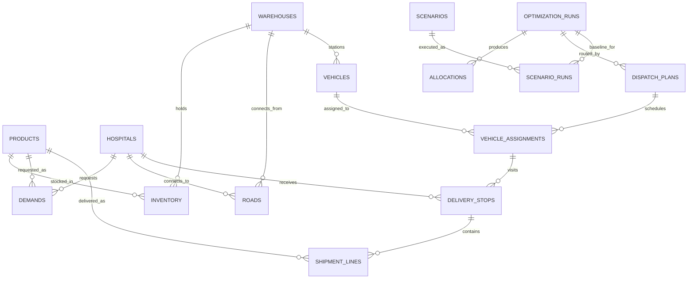

# MEDILOGIX — Database Design

---

## 1. Persistence Architecture

- **ORM**: SQLAlchemy 2.0 declarative models (`backend/app/models/`).
- **Database Support**: SQLite (`sqlite:///./medilogix_dev.db`) for local development and PostgreSQL (`postgresql+psycopg2://...`) for production deployments, configured via `DATABASE_URL`.
- **Integrity**: SQLite `PRAGMA foreign_keys=ON` enabled on connections; strict `RESTRICT` / `CASCADE` referential actions protect operational and historical records from accidental corruption.
- **Non-Destructive Additive Migrations**: `backend/app/database/migrations.py` (`ensure_additive_columns`) automatically applies safe additive `ALTER TABLE` migrations (such as `vehicle_assignments.route_geometry_json`) without resetting tables or modifying historical rows.

---

## 2. Complete Relational Schema (16 Tables)

| # | Table | Model | Primary Key | Key Columns & Foreign Keys |
| :-: | :--- | :--- | :--- | :--- |
| 1 | `warehouses` | `Warehouse` | `id` | `code` (unique), `name`, `area`, `city`, `latitude`, `longitude`, `storage_capacity_units`, `status`, `is_synthetic_hub` |
| 2 | `hospitals` | `Hospital` | `id` | `code` (unique), `name`, `area`, `city`, `latitude`, `longitude`, `priority_level` (`critical`/`high`/`normal`), `bed_capacity`, `status`, `is_synthetic_profile` |
| 3 | `products` | `Product` | `id` | `code` (unique), `name`, `category`, `unit`, `unit_weight_kg`, `base_transport_cost_per_km`, `cold_chain_required` |
| 4 | `inventory` | `Inventory` | `id` | `inventory_code` (unique), `warehouse_id` (FK → `warehouses.id`), `product_id` (FK → `products.id`), `quantity_available`, `quantity_reserved`, `reorder_level`; unique `(warehouse_id, product_id)` |
| 5 | `demands` | `Demand` | `id` | `demand_code` (unique), `hospital_id` (FK → `hospitals.id`), `product_id` (FK → `products.id`), `quantity_requested`, `priority_level`, `status` (`open`/`partially_fulfilled`/`fulfilled`/`cancelled`) |
| 6 | `roads` | `Road` | `id` | `route_code` (unique), `warehouse_id` (FK → `warehouses.id`), `hospital_id` (FK → `hospitals.id`), `distance_km`, `estimated_travel_time_min`, `base_transport_cost_per_unit`, `is_available`, `road_condition`, `data_note` |
| 7 | `vehicles` | `Vehicle` | `id` | `vehicle_code` (unique), `warehouse_id` (FK → `warehouses.id`), `vehicle_type` (`medical_truck`/`medical_van`), `capacity_kg`, `status` (`available`/`maintenance`/`unavailable`) |
| 8 | `scenarios` | `Scenario` | `id` | `name` (unique), `description`, `scenario_type`, `parameters_json`, `is_active` |
| 9 | `optimization_runs` | `OptimizationRun` | `id` | `run_code` (unique), `model_type`, `scenario_id` (nullable FK → `scenarios.id`), `solver_status`, `total_cost`, `total_allocated`, `total_unmet_demand`, `execution_time_ms`, `summary_json` |
| 10 | `allocations` | `Allocation` | `id` | `optimization_run_id` (FK → `optimization_runs.id`, `CASCADE`), `warehouse_id` (FK), `hospital_id` (FK), `product_id` (FK), `quantity_allocated`, `unmet_quantity`, `transport_cost` |
| 11 | `deliveries` | `Delivery` | `id` | Legacy Phase 1 delivery record table preserved for backward compatibility (`optimization_run_id`, `vehicle_id`, `warehouse_id`, `hospital_id`, `route_distance_km`, `estimated_duration_min`, `status`, `route_sequence_json`) |
| 12 | `dispatch_plans` | `DispatchPlan` | `id` | `plan_code` (unique), `optimization_run_id` (FK → `optimization_runs.id`, `RESTRICT`), `status`, `solver_status`, `total_vehicles_used`, `total_routes`, `total_stops`, `total_distance_km`, `estimated_duration_min`, `total_weight_kg`, `allow_multi_trip`, `allow_split_deliveries`, `notes`, `summary_json` |
| 13 | `vehicle_assignments` | `VehicleAssignment` | `id` | `dispatch_plan_id` (FK → `dispatch_plans.id`, `CASCADE`), `vehicle_id` (FK → `vehicles.id`, `RESTRICT`), `warehouse_id` (FK → `warehouses.id`, `RESTRICT`), `trip_number`, `status`, `total_load_kg`, `capacity_kg`, `utilization_pct`, `route_distance_km`, `estimated_duration_min`, `route_coordinates_json`, `route_geometry_json` *(Phase 5 nullable JSON)* |
| 14 | `delivery_stops` | `DeliveryStop` | `id` | `vehicle_assignment_id` (FK → `vehicle_assignments.id`, `CASCADE`), `hospital_id` (FK → `hospitals.id`, `RESTRICT`), `stop_sequence`, `status`, `leg_distance_km`, `cumulative_distance_km`, `estimated_arrival_min`, `stop_weight_kg`, `notes` |
| 15 | `shipment_lines` | `ShipmentLine` | `id` | `delivery_stop_id` (FK → `delivery_stops.id`, `CASCADE`), `product_id` (FK → `products.id`, `RESTRICT`), `quantity_planned`, `quantity_delivered`, `unit_weight_kg`, `total_weight_kg` |
| 16 | `scenario_runs` | `ScenarioRun` | `id` | `simulation_code` (unique), `scenario_id` (FK → `scenarios.id`, `CASCADE`), `baseline_run_id` (FK → `optimization_runs.id`, `RESTRICT`), `status`, `parameters_json`, `baseline_metrics_json`, `disrupted_metrics_json`, `comparison_json`, `disrupted_routes_json`, `notes`, `execution_time_ms` |

---

## 3. Entity-Relationship Diagram

---

## 4. Key Integrity Rules & Lifecycle Constraints

- **Foreign-Key Deletion Protection**: Deleting a warehouse or hospital referenced by inventory, demands, roads, allocations, or dispatch records returns `409 Conflict` instead of creating orphan rows.
- **Dispatch Lifecycle State Machine**:
  - `planned` → `dispatched`, `cancelled`
  - `dispatched` → `in_transit`, `partially_delivered`, `delivered`, `cancelled`
  - `in_transit` → `partially_delivered`, `delivered`, `cancelled`
  - `partially_delivered` → `in_transit`, `delivered`, `cancelled`
  - `delivered` and `cancelled` are terminal states.
- **Shipment Conservation**: All newly generated `shipment_lines` initialize `quantity_delivered = 0.0`, enforce `0 <= quantity_delivered <= quantity_planned`, and never auto-deduct live `inventory`.
- **Scenario History Immutability**: Every disaster simulation persists a frozen `ScenarioRun` snapshot (`baseline_metrics_json`, `disrupted_metrics_json`, `comparison_json`, `disrupted_routes_json`) without altering live operational tables.
