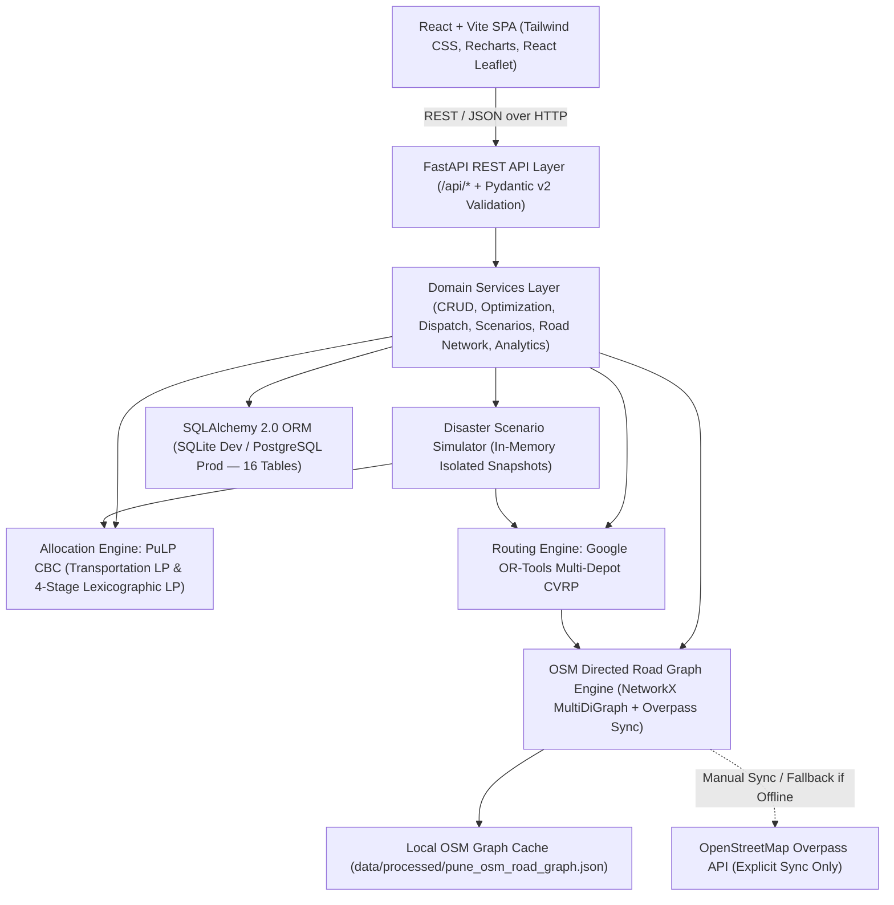
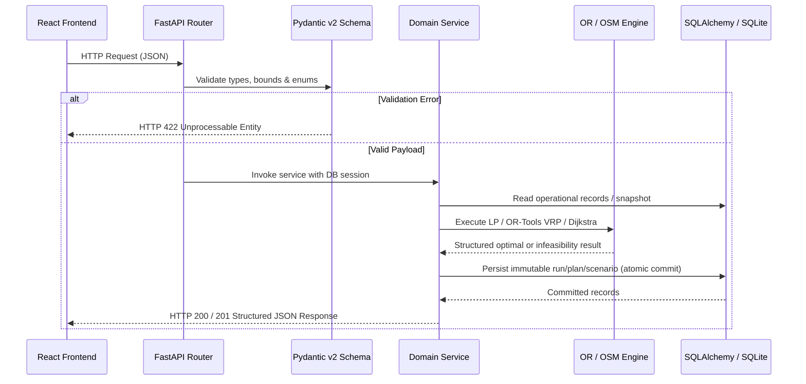
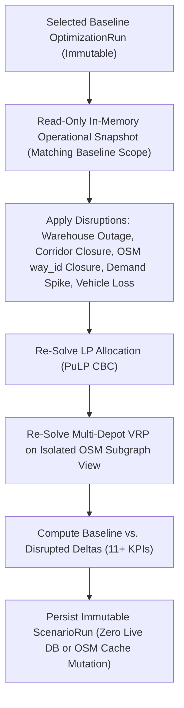
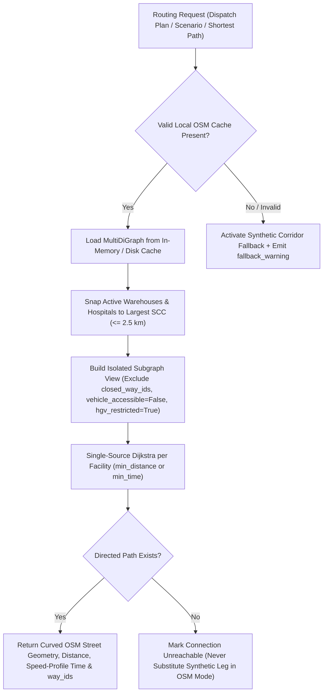

# MEDILOGIX — System Architecture

MEDILOGIX follows a decoupled, service-oriented three-tier web architecture with a dedicated **Operations Research, Vehicle Routing, OpenStreetMap Road-Network, and Disaster Simulation Engine** layer.

---

## 1. Overall System Architecture

---

## 2. Backend Request Lifecycle Flow

---

## 3. Decoupled LP-to-VRP Allocation & Dispatch Workflow

```mermaid
flowchart LR
    LIVE["Live Operational Tables (Warehouses, Hospitals, Inventory, Demands, Roads)"]
    P3["Phase 3: PuLP CBC Solver (Transportation LP or 4-Stage Lexicographic LP)"]
    RUN["Immutable OptimizationRun + Allocation Records"]
    DEPOT["Per-Depot Grouping by Warehouse Origin"]
    MAT["Directed OSM Distance/Time Matrix (or Synthetic Fallback)"]
    OR["Phase 4–5: Google OR-Tools CVRP (1D Weight Capacity, Split Loads, Multi-Wave)"]
    PLAN["Persisted DispatchPlan -> VehicleAssignment (route_geometry_json) -> DeliveryStop -> ShipmentLine"]
    LIFE["Validated Dispatch Lifecycle (planned -> dispatched -> in_transit -> delivered)"]

    LIVE -->|Read-Only Snapshot| P3
    P3 --> RUN
    RUN -->|Exact Quantity Conservation| DEPOT
    DEPOT --> MAT
    MAT --> OR
    OR --> PLAN
    PLAN --> LIFE
```

---

## 4. Isolated Disaster Scenario Simulation Workflow

---

## 5. OpenStreetMap Road-Network Routing & Fallback Workflow

---

## 6. Layer Responsibilities & Portability

- **API Routers (`backend/app/api/routes/`)**: Thin HTTP handlers delegating to services; zero embedded solver math.
- **Schemas (`backend/app/schemas/`)**: Strict Pydantic v2 input/output contracts.
- **Optimization & GIS (`backend/app/optimization/`)**: Pure Python Operations Research and NetworkX modules cleanly unit-testable without HTTP or DB coupling.
- **Database Migrations (`backend/app/database/migrations.py`)**: Safe, idempotent additive column migrations preserving historical SQLite data.
- **Configuration**: Environment-driven via `.env` (`DATABASE_URL`, `CORS_ORIGINS`, `GEO_*`, `OSM_*`), portable between SQLite and PostgreSQL.
